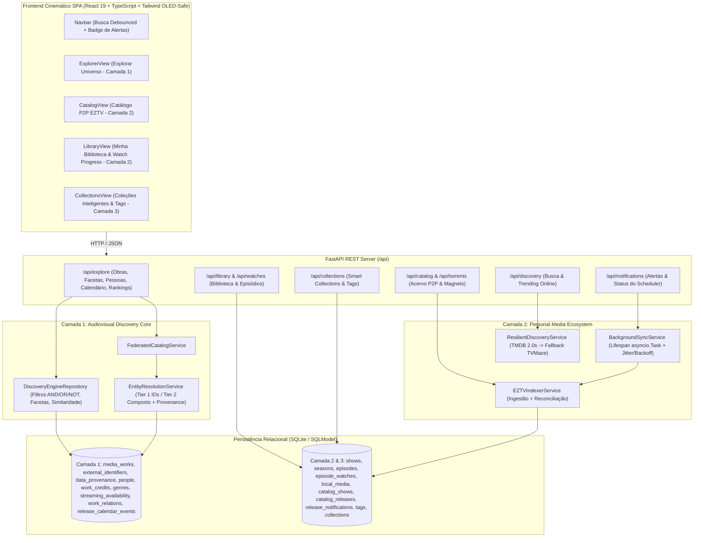

# TV Pirata 🏴‍☠️

[](#)
[](#)
[](#)
[](#)
[](#)
[](#)
[](#)
[](#)

> **Audiovisual Discovery Platform & Personal Media Ecosystem (Discovery-First).**  
> *Motor de descoberta audiovisual multi-formato (Filmes, Séries, Minisséries, Documentários, Animações e Especiais), resolução de identidade multi-fonte com procedência por atributo, filtragem booleana (`AND`/`OR`/`NOT`), descoberta relacional por filmografia e colaborações, calendário unificado de estreias e ecossistema pessoal de biblioteca, rastreamento de episódios, catálogo P2P EZTV e notificações automáticas em segundo plano.*

---

## 1. 🎯 Visão Geral e Posicionamento Estratégico

O **TV Pirata** evoluiu de um gerenciador de mídia tradicional para uma **Plataforma de Descoberta Audiovisual (Discovery-First)** desenhada para eliminar o custo de exploração fragmentada entre múltiplos serviços de streaming (Netflix, Prime Video, Max, Apple TV+, Disney+, MUBI) e catálogos P2P/locais.

A plataforma é estruturada em uma **Arquitetura de 3 Camadas**:

| Camada | Escopo e Responsabilidades | Módulos Principais |
| :--- | :--- | :--- |
| **Camada 1 — Audiovisual Discovery Core** | Domínio canônico multi-formato (`MediaWork`), resolução de identidade em níveis de confiança (`EntityResolutionService`), rastreamento de procedência por campo (`DataProvenance`), notas preservadas por fonte (`ratings_breakdown`), motor de filtragem booleana (`AND`/`OR`/`NOT`), facetas dinâmicas, descoberta por filmografia/colaborações, calendário unificado de estreias e cruzamento instantâneo de disponibilidade com o acervo EZTV (`eztv_available`, `eztv_show_id`). | `catalog_domain.py`, `entity_resolution.py`, `federated_catalog.py`, `discovery_engine.py`, `explore.py`, `ExplorerView.tsx`, `ShowBadges.tsx`, `EztvBadge.tsx` |
| **Camada 2 — Personal Media Ecosystem** | Persistência dual-database (`data/tv_pirata.db` + `data/eztv_metadata.db`), biblioteca pessoal (`ShowRecord`), controle granular de progresso por temporada/episódio (`EpisodeWatchRecord`), disponibilidade em rede local SMB (`LocalMediaRecord`), catálogo dedicado de séries e episódios EZTV (`EZTVShow`, `EZTVEpisodeCatalog`) com busca acelerada via `FTS5` (`shows_fts`), telemetria P2P (`CatalogShow`, `CatalogRelease`) e sincronização periódica em segundo plano com alertas de novos episódios (`ReleaseNotificationRecord`, `BackgroundSyncService`). | `db.py`, `eztv_db.py`, `cache.py`, `library.py`, `catalog.py`, `notification.py`, `catalog_indexer.py`, `scheduler.py`, `LibraryView.tsx`, `CatalogView.tsx` |
| **Camada 3 — Personalization & Intelligence** | Motor objetivo de similaridade multi-critério (interseção de gêneros, diretores/criadores, elenco, formato e proximidade temporal com justificativa explícita), coleções inteligentes (`CollectionRecord` + `filter_criteria`) e exclusão de títulos já assistidos. | `discovery_engine.py`, `collections.py`, `CollectionsView.tsx` |

---

## 2. 🏗️ Arquitetura do Sistema (3 Camadas)



---

## 3. ✨ Matriz de Capacidades por Módulo

### 3.1. Camada 1 — Audiovisual Discovery Core (`ADR-008`)
- **Domínio Canônico Multi-Formato (`MediaWork`):** Suporta `movie`, `tv_show`, `mini_series`, `documentary`, `animation` e `special` independentemente de arquivos locais ou torrents.
- **Resolução de Identidade Multi-Fonte (`EntityResolutionService`):**
  - **Tier 1 (`deterministic`, confiança `1.0`):** Reconciliação exata por `imdb_id`, `tmdb_id`, `tvmaze_id`, `trakt_id`, `wikidata_id` ou `eztv_id`.
  - **Tier 2 (`high`, confiança `0.90`):** Reconciliação composta (`normalized_title` + `format` + `release_year` exato) com proteção anti-colisão para homônimos e remakes de anos distintos (ex.: *Dune* 1984 vs *Dune* 2021).
- **Rastreabilidade de Procedência (`DataProvenance`) e Notas por Fonte (`ratings_breakdown`):** Preserva a fonte de cada atributo (`title`, `synopsis`, `poster_url`, `runtime_minutes`, `genres`) e exibe as notas individuais de cada plataforma (`imdb`, `tmdb`, `tvmaze`, `rotten_tomatoes`, `metacritic`) sem médias opacas.
- **Motor de Filtragem Booleana e Facetas (`DiscoveryEngineRepository`):**
  - Inclusão de gêneros em modo **`OR`** (qualquer gênero selecionado) ou **`AND`** (interseção estrita de todos os gêneros selecionados) + exclusão explícita (**`NOT`**).
  - Filtros combináveis por formato, janela de anos (`year_min`..`year_max`), nota mínima (`rating_min`), duração (`runtime_min`..`runtime_max`), país, idioma original, plataforma de streaming, diretor, ator, criador, disponibilidade em torrent P2P e ocultação de obras já assistidas (`exclude_watched`).
  - Contadores dinâmicos de facetas recalculados em tempo real para o subconjunto filtrado.
- **Descoberta Relacional e Similaridade:**
  - Filmografia completa de diretores, criadores, roteiristas e atores (`/api/explore/people/{id}`).
  - Interseção de colaborações recorrentes entre dois profissionais (`/api/explore/people/collaborations`).
  - Cálculo determinístico de obras similares com justificativa transparente (`shared_reasons`) e relações explícitas (`remake_of`, `spin_off_of`, `sequel_to`, `adapted_from`).
- **Calendário Unificado de Lançamentos:** Eventos de estreia mundial, episódios inéditos, lançamentos em streaming e finais de temporada (`/api/explore/calendar`).

### 3.2. Camada 2 — Personal Media Ecosystem & Performance Dual-SQLite (`ADR-001` a `ADR-007`, `ADR-009`, `ADR-010`)
- **Arquitetura Dual-Database (`ADR-009`):** Isolamento físico entre `data/tv_pirata.db` (descoberta multi-provedor, biblioteca pessoal, progresso, notificações e telemetria P2P) e `data/eztv_metadata.db` (`860` séries em `shows` e `140.571` episódios em `episodes_catalog`), com entrelaçamento determinístico por `imdb_id`/`slug` e badges visuais permanentes de status (`StatusBadge`), provedor de streaming (`ProviderBadge`) e disponibilidade EZTV (`EztvBadge`) em todos os canais da UI.
- **Engenharia de Alta Performance Dual-SQLite (`ADR-010`):**
  - Listener automático de conexão SQLAlchemy aplicando `PRAGMA journal_mode=WAL`, `synchronous=NORMAL`, `temp_store=MEMORY`, `cache_size=-64000` (64 MB) e `mmap_size=268435456` (256 MB).
  - Estatísticas materializadas de episódios (`episodes_count`, `max_season`, `max_episode`) em `shows`, índice virtual invertido `FTS5` (`shows_fts`) sincronizado por triggers e `EngineScopedCache` com fingerprint de versão de tabela, reduzindo a latência de `list_shows` e `get_curated_sections` em mais de **98%** ($965\text{ ms} \rightarrow 15\text{ ms}$ e $692\text{ ms} \rightarrow 4,7\text{ ms}$).
- **Provedores Online com Fallback Transparente (`ResilientDiscoveryService`):** Consulta primária ao **TMDB** (timeout estrito de `2.0s`) com fallback automático para **TVMaze** sem interrupção para o usuário.
- **Biblioteca Pessoal e Progresso Granular (`LibraryRepository`):** Acompanhamento por status (`watching`, `plan_to_watch`, `completed`, `paused`, `abandoned`), notas pessoais, histórico imutável de episódios assistidos (`EpisodeWatchRecord`) e mapeamento de arquivos locais via **SMB** (`LocalMediaRecord`).
- **Catálogo Persistente P2P da EZTV (`EZTVIndexerService`):** Ingestão multi-página de torrents com enriquecimento de metadados, filtros de saúde (`min_seeds`) e disparo em 1 clique de links `magnet:?`.
- **Crawler Multi-Provedor Resiliente a Cloudflare (`scripts/eztv-metadata-catalog.py`):** Utilitário CLI resumível em SQLite (`WAL`) com detecção automática de desafios Cloudflare, fallback nativo para a API JSON oficial (`/api/get-torrents`) e enriquecimento cruzado em cascata (EZTV + TVMaze por IMDb/nome + TMDB Watch Providers).
- **Auto-Sync Assíncrono & Release Notifier (`BackgroundSyncService`):** Agendador nativo em `asyncio.Task` integrado ao `lifespan` do FastAPI com jitter de $\pm 10\%$, backoff exponencial, parada graciosa em $\le 3.0\text{s}$ e geração idempotente de alertas (`ReleaseNotificationRecord`) quando novos episódios de séries acompanhadas ganham sementes na EZTV.

---

## 4. 📁 Estrutura Canônica do Repositório

```text
tv-pirata/
├── src/
│   ├── backend/                        # API REST Assíncrona (FastAPI + SQLModel)
│   │   ├── api/                        # Roteadores REST (/api/*)
│   │   │   ├── explore.py              # Camada 1: /api/explore (Obras, Facetas, Pessoas, Calendário)
│   │   │   ├── discovery.py            # /api/discovery (Trending e Busca Resiliente TMDB/TVMaze)
│   │   │   ├── catalog.py              # Camada 2: /api/catalog (Catálogo P2P Persistente EZTV)
│   │   │   ├── library.py              # Camada 2: /api/library (CRUD da Biblioteca Pessoal)
│   │   │   ├── watches.py              # Camada 2: /api/watches (Progresso de Episódios/Temporadas)
│   │   │   ├── notifications.py        # Camada 2: /api/notifications (Alertas & Status do Scheduler)
│   │   │   ├── torrents.py             # Camada 2: /api/torrents (Lookup de Magnets por IMDb ID)
│   │   │   └── collections.py          # Camada 3: /api/collections (Tags & Smart Collections)
│   │   ├── core/
│   │   │   ├── cache.py                # EngineScopedCache thread-safe com fingerprint (ADR-010)
│   │   │   ├── config.py               # Configurações tipadas (Pydantic Settings)
│   │   │   └── database.py             # Engines dual-SQLite (tv_pirata.db + eztv_metadata.db), PRAGMAs e FTS5
│   │   ├── models/
│   │   │   ├── catalog_domain.py       # Camada 1: 10 entidades SQLModel (MediaWork, DataProvenance, etc.)
│   │   │   ├── db.py                   # Camada 2/3: 11 entidades SQLModel (ShowRecord, CatalogShow, etc.)
│   │   │   ├── eztv_db.py              # Camada 2: Modelos isolados EZTVShow e EZTVEpisodeCatalog (ADR-009)
│   │   │   └── unified.py              # Contratos Pydantic v2 (UnifiedShow, TorrentRelease)
│   │   ├── providers/
│   │   │   ├── base.py                 # Protocolo abstrato BaseMetadataProvider
│   │   │   ├── tmdb.py                 # Cliente assíncrono TMDB API v3
│   │   │   ├── tvmaze.py               # Cliente assíncrono TVMaze (Fallback público)
│   │   │   ├── eztv.py                 # Cliente assíncrono EZTV Torrents API
│   │   │   └── discovery_service.py    # Orquestrador ResilientDiscoveryService
│   │   ├── repositories/
│   │   │   ├── discovery_engine.py     # Camada 1: Filtragem booleana, facetas, filmografia e similaridade
│   │   │   ├── catalog.py              # Camada 2: Consultas paginadas do acervo EZTV
│   │   │   ├── library.py              # Camada 2/3: Upsert transacional, watches e smart collections
│   │   │   └── notification.py         # Camada 2: Gestão de alertas de novos episódios
│   │   ├── services/
│   │   │   ├── entity_resolution.py    # Camada 1: Reconciliação Tier 1/Tier 2 e DataProvenance
│   │   │   ├── federated_catalog.py    # Camada 1: Federação multi-fonte e ponte com Camada 2
│   │   │   ├── curated_catalog_seed.json # Dataset canônico multi-formato (Filmes, Séries, Docs, Animes)
│   │   │   ├── catalog_indexer.py      # Camada 2: Indexador EZTV e reconciliação de lançamentos
│   │   │   └── scheduler.py            # Camada 2: BackgroundSyncService (asyncio Lifespan)
│   │   ├── static/                     # Favicons e bundle compilado da SPA (static/dist)
│   │   └── main.py                     # Entrypoint FastAPI, Lifespan e entrega da SPA
│   └── frontend/                       # Single-Page Application (React 19 + TypeScript + Vite)
│       ├── src/
│       │   ├── components/
│       │   │   ├── Navbar.tsx          # Navegação global, busca debounced e badge de notificações
│       │   │   ├── ExplorerView.tsx    # Camada 1: "Explorar Universo" (Filtros AND/OR/NOT, Dossiê, Pessoas)
│       │   │   ├── HeroBanner.tsx      # Destaque cinematográfico principal
│       │   │   ├── ShowCarousel.tsx    # Carrosséis horizontais com scroll-snap
│       │   │   ├── CatalogView.tsx     # Camada 2: Explorador do acervo P2P EZTV
│       │   │   ├── LibraryView.tsx     # Camada 2: Biblioteca pessoal e alertas de novos episódios
│       │   │   ├── CollectionsView.tsx # Camada 3: Coleções inteligentes e tags
│       │   │   ├── ShowDetailModal.tsx # Modal de temporadas, episódios e status SMB
│       │   │   ├── TorrentModal.tsx    # Modal de releases 4K/1080p/720p e links magnet
│       │   │   ├── EztvBadge.tsx       # Badge vetorial de disponibilidade no catálogo EZTV (ADR-009)
│       │   │   └── ShowBadges.tsx      # Badges permanentes de Status e Provedor de Streaming
│       │   ├── services/api.ts         # Cliente HTTP tipado para todas as rotas /api/*
│       │   ├── types.ts                # Interfaces TypeScript espelhando os contratos do backend
│       │   └── App.tsx                 # Roteamento de abas e estado global da SPA
│       └── package.json
├── scripts/
│   ├── quality_gate.sh                 # Gate determinístico pré-commit (Ruff + Pytest)
│   ├── sync_catalog.py                 # CLI para ingestão de páginas de releases da EZTV
│   └── eztv-metadata-catalog.py        # Crawler concorrente de 3 níveis (EZTV Showlist + Ficha + TVMaze)
├── tests/
│   ├── fixtures/                       # Payloads JSON determinísticos (TMDB, TVMaze, EZTV)
│   ├── unit/                           # Testes unitários (modelos, entity resolution, discovery engine, scheduler)
│   └── integration/                    # Testes de integração REST (/api/explore, /api/catalog, /api/notifications, etc.)
├── docs/
│   ├── adr/                            # Architecture Decision Records (ADR-001 a ADR-008 + ADR-INDEX.md)
│   ├── governance/                     # Registro estruturado de débitos técnicos (tech-debt-registry.json)
│   ├── reports/                        # Relatórios de auditoria e arquivamento de ADRs
│   └── DOCUMENTATION_AUDIT_REPORT.md   # Relatório de conformidade dos 6 Pilares SOTA
├── README.md                           # Pilar 1: Visão geral executiva e arquitetura
├── CHANGELOG.md                        # Pilar 2: Histórico cronológico SemVer (Keep a Changelog)
├── USAGE.md                            # Pilar 3: Manual prático de operação, CLI e exemplos de API
├── RELEASE-NOTES.md                    # Pilar 4: Notas de versão executivas e guia de atualização
├── STATE.md                            # Pilar 5: Memória persistente de estado do agente
└── AGENTS.md / GEMINI.md               # Pilar 6: Governança e invariantes de engenharia (SSOT)
```

---

## 5. 🚀 Primeiros Passos (Quick Start)

### Pré-requisitos
- **Python 3.10+** (ambiente homologado com Python 3.14 via `uv`)
- **Node.js 20+ / npm** (apenas caso deseje recompilar ou desenvolver o frontend SPA; o bundle de produção já é versionado em `src/backend/static/dist/`)

### Instalação e Execução Rápida
```bash
# 1. Copiar o template de variáveis de ambiente
cp .env.example .env

# 2. Instalar dependências Python (produção + desenvolvimento/testes)
uv pip install -e ".[dev]"

# 3. (Opcional) Compilar o bundle de produção do frontend React 19
make build-front

# 4. Iniciar o servidor integrado FastAPI + SPA em http://127.0.0.1:8000
make run
```

Acesse no navegador:
- **Aplicação Web Cinemática (SPA):** `http://127.0.0.1:8000/`
- **Documentação Interativa OpenAPI (Swagger):** `http://127.0.0.1:8000/docs`

---

## 6. 🛠️ Matriz de Comandos (`Makefile`)

| Comando | Descrição |
| :--- | :--- |
| `make run` | Inicia o servidor integrado FastAPI + SPA em `http://127.0.0.1:8000` com auto-reload |
| `make build-front` | Compila a SPA React 19 + TypeScript + Tailwind para `src/backend/static/dist/` |
| `make dev-front` | Inicia o servidor Vite com Hot Module Replacement (HMR) em `http://127.0.0.1:5173` |
| `make sync-catalog` | Sincroniza e enriquece as páginas mais recentes de torrents da EZTV no banco local |
| `make test` | Executa a suíte completa de **63 testes automatizados** (100% offline/herméticos) |
| `make lint` | Executa análise estática de código Python via `ruff check src/ tests/` |
| `make format` | Formata automaticamente o código-fonte com `ruff format src/ tests/` |
| `make setup-hooks` | Instala o `scripts/quality_gate.sh` como hook `pre-commit` do Git |
| `make clean` | Remove caches temporários (`__pycache__`, `.pytest_cache`, `.ruff_cache`, `dist`) |

---

## 7. 🏛️ Governança Arquitetural (ADRs)

Todas as decisões estruturais estão documentadas e auditadas em [docs/adr/ADR-INDEX.md](./docs/adr/ADR-INDEX.md) com Certificados de Evidência (`ADR-001-ER.md` a `ADR-010-ER.md`):
- **ADR-001 a ADR-004 (Consolidadas/Arquivadas):** Fundação SMB, provedores TMDB/TVMaze com fallback de 2.0s, integração EZTV e persistência SQLModel + FastAPI.
- **ADR-005 (Consolidada/Arquivada):** Frontend Cinemático SPA (React 19 + Tailwind CSS) com Design System OLED-Safe (`#090a0f`).
- **ADR-006 (Consolidada/Arquivada):** Catálogo Local Persistente da EZTV e Motor de Ingestão P2P.
- **ADR-007 (Consolidada/Arquivada):** Background Auto-Sync, Agendamento Assíncrono (`lifespan`) e Notificador de Novos Lançamentos.
- **ADR-008 (Consolidada/Arquivada):** Fundação do Audiovisual Discovery Core (Camada 1): Domínio Canônico Multi-Formato, Resolução de Identidade com Procedência e Motor de Descoberta.
- **ADR-009 (Consolidada/Arquivada):** Separação de Bases (`tv_pirata.db` vs `eztv_metadata.db`), Entrelaçamento EZTV e Sistema Universal de Badges (`StatusBadge`, `ProviderBadge`, `EztvBadge`).
- **ADR-010 (Consolidada/Arquivada):** Otimização de Desempenho de Leitura Dual-SQLite (`PRAGMA`s WAL/mmap), Estatísticas Materializadas, `EngineScopedCache` com Fingerprint e Índice Virtual `FTS5`.
