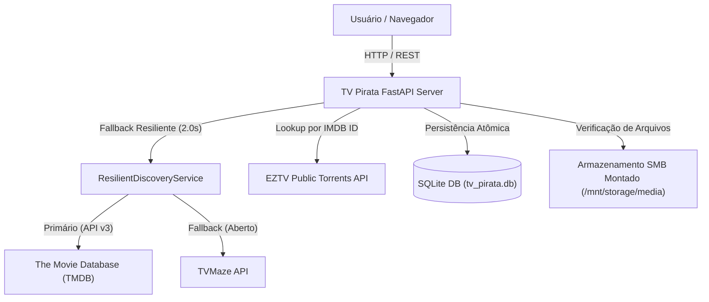

# TV Pirata 🏴‍☠️

[](#)
[](#)
[](#)
[](#)
[](#)

> **Seu "Netflix Pessoal" para Descoberta, Controle e Administração de Séries e Filmes.**  
> *Painel web moderno com foco em descoberta online, tracking granular de progresso (assistido/não assistido), categorização rica e gestão de acervo distribuído via SMB na rede doméstica.*

---

## 1. 🎯 Visão Geral do Projeto

O **TV Pirata** é uma central de mídia personalizada desenvolvida para quem consome séries e filmes obtidos via torrent ou downloads manuais e disponibilizados via compartilhamento de rede (**SMB**) para reprodução em Smart TVs, TV Boxes, Kodi ou VLC.

Diferente de media centers pesados voltados primariamente para transcodificação e streaming contínuo (Plex/Emby/Jellyfin), o foco central do **TV Pirata** é:
- **Descoberta Visual e Ágil:** Interface cinematográfica estilo Netflix (carrosséis, trending, detalhes, trailers, pôsteres em alta definição).
- **Provedores de Descoberta Online:** Agregação de APIs líderes de mercado (**TMDB**, **TVMaze**) com fallback automático transparente.
- **Obtenção Desacoplada de Torrents:** Integração direta com a API pública da **EZTV** por `imdb_id` para expor magnets ordenados por saúde/seeds em 1 clique.
- **Controle Total de Progresso:** Status de acompanhamento por série, temporada e episódio (Quero Ver, Assistindo, Assistido, Abandonado, Pausado).
- **Categorização e Tags Personalizadas:** Gêneros, coleções inteligentes (`filter_criteria`), notas pessoais e filtros dinâmicos.
- **Gestão e Mapeamento de Arquivos SMB:** Associação entre a série/filme e sua presença/caminho no servidor de arquivos local da casa com preservação estrita de histórico.

---

## 2. 🏗️ Arquitetura e Fluxo de Dados



---

## 3. 📁 Estrutura Canônica do Repositório

```text
tv-pirata/
├── src/                      # Código-fonte da aplicação
│   ├── __init__.py
│   └── backend/              # API REST assíncrona (FastAPI)
│       ├── __init__.py
│       ├── models/           # Contratos unificados de domínio (Pydantic v2)
│       │   ├── __init__.py
│       │   └── unified.py    # UnifiedShow, UnifiedSeason, TorrentRelease
│       └── providers/        # Clientes de APIs de descoberta e distribuição
│           ├── __init__.py
│           ├── base.py       # BaseMetadataProvider (Protocolo abstrato)
│           ├── tmdb.py       # Provedor The Movie Database (TMDB)
│           ├── tvmaze.py     # Provedor TVMaze (Fallback público)
│           ├── eztv.py       # Provedor EZTV (Magnets e sementes)
│           └── discovery_service.py # ResilientDiscoveryService
├── tests/                    # Suíte automatizada de testes herméticos
│   ├── fixtures/             # Payloads estáticos reais (TMDB, TVMaze, EZTV)
│   ├── unit/                 # Testes unitários com respx e Pydantic
│   └── integration/          # Testes de integração de fallback e contratos
├── docs/                     # Documentação viva e governança
│   ├── adr/                  # Architecture Decision Records
│   │   ├── ADR-INDEX.md      # Ledger e índice canônico de ADRs
│   │   ├── ADR-001.md        # Arquitetura Fundamental do TV Pirata
│   │   ├── ADR-002.md        # Provedores de Descoberta, Fallback e Mídia
│   │   ├── ADR-003.md        # Implementação do Contrato Unificado e EZTV
│   │   └── elevation-ADR-002/ # Relatórios de elevação adversarial
│   └── governance/           # Registros de débito técnico e governança
├── scripts/                  # Utilitários de qualidade e automação
│   └── quality_gate.sh       # Pre-commit Quality Gate local
├── AGENTS.md                 # Single Source of Truth para IA e AgentOps
├── GEMINI.md                 # Proxy determinístico referenciando AGENTS.md
├── Makefile                  # Comandos e automações cross-platform
├── pyproject.toml            # Declaração de dependências e configuração de testes
└── .env.example              # Template seguro de variáveis de ambiente
```

---

## 4. 🚀 Primeiros Passos

### Pré-requisitos
- Python 3.10+ (preferencialmente Python 3.14 provisionado via `uv`)
- Make (opcional)

### Configuração Inicial
```bash
# 1. Copiar o arquivo de variáveis de ambiente
cp .env.example .env

# 2. Inicializar dependências do ambiente virtual
uv pip install -e ".[dev]"
```

### Comandos de Verificação
```bash
# Executar a suíte completa de testes (100% offline via respx)
make test

# Executar o linter estático
make lint

# Ativar o Quality Gate pré-commit local
make setup-hooks
```
