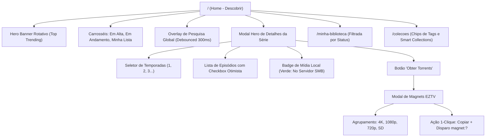

# Blueprint Arquitetural: ADR-005 — Frontend Cinemático TV Pirata

## 1. Visão Geral da Arquitetura do Frontend

O frontend do **TV Pirata** é uma Single-Page Application (SPA) reativa construída com React 19, TypeScript e Tailwind CSS v3, empacotada via Vite e servida estaticamente pelo backend FastAPI.

```
┌────────────────────────────────────────────────────────────────────────┐
│                        ARQUITETURA DO FRONTEND                         │
├────────────────────────────────────────────────────────────────────────┤
│ 1. CAMADA DE APRESENTAÇÃO (React Components & Layouts)                 │
│    ├── Navbar Flutuante (Busca debounced, abas de navegação, status)   │
│    ├── Hero Banner (Backdrop dinâmico, sinopse, play/trailer/detalhes) │
│    ├── Carrosséis de Streaming (Trending, Em Andamento, Minha Lista)   │
│    ├── Modal Hero de Detalhes (Tabs de temporadas, checklist otimista) │
│    ├── Modal de Torrents (Releases EZTV agrupadas por resolução/seeds) │
│    └── Hub de Coleções & Tags (Filtros visuais em chips interativos)   │
├────────────────────────────────────────────────────────────────────────┤
│ 2. CAMADA DE ESTADO & CONSUMO DE DADOS                                 │
│    ├── api-client.ts (Fetch tipado consumindo /api do FastAPI)         │
│    ├── useWatchProgress.ts (Toggle otimista de episódios/temporadas)   │
│    └── ToastContext.tsx (Notificações não-bloqueantes de 3 segundos)   │
├────────────────────────────────────────────────────────────────────────┤
│ 3. CAMADA DE DESIGN SYSTEM (Tailwind & Tokens OLED-Safe)               │
│    ├── Canvas: #090a0f | Superfície: #131722 | Superfície Elevada: #1e293b │
│    ├── Destaque Rubro: #d81f26 | Destaque Suave: #e50914              │
│    └── Acessibilidade: Contraste AAA (>7:1), Touch Targets >= 44x44px  │
├────────────────────────────────────────────────────────────────────────┤
│ 4. CAMADA DE ENTREGA & HOMELAB HOSTING                                 │
│    ├── Vite gera build estático otimizado em src/backend/static/dist/  │
│    └── FastAPI (main.py) serve index.html em / e estáticos em /assets  │
└────────────────────────────────────────────────────────────────────────┘
```

## 2. Mapa de Rotas e Telas da SPA



## 3. Contratos de Dados do Frontend (`types.ts`)

```typescript
export interface UnifiedEpisode {
  id?: number;
  episode_number: number;
  season_number: number;
  title: string;
  overview: string;
  air_date?: string;
  rating?: number;
  is_watched?: boolean;
  is_available?: boolean;
}

export interface UnifiedSeason {
  id?: number;
  season_number: number;
  name: string;
  overview: string;
  poster_url?: string;
  episode_count: number;
  episodes: UnifiedEpisode[];
}

export interface UnifiedShow {
  id: number;
  tmdb_id?: number;
  tvmaze_id?: number;
  imdb_id?: string;
  title: string;
  original_title?: string;
  overview: string;
  poster_url?: string;
  backdrop_url?: string;
  rating: number;
  genres: string[];
  first_air_date?: string;
  status?: string;
  source_provider: string;
  seasons: UnifiedSeason[];
}

export interface TorrentRelease {
  id: number;
  hash: string;
  filename: string;
  title: string;
  season: number;
  episode: number;
  magnet_url: string;
  torrent_url?: string;
  seeds: number;
  peers: number;
  size_bytes: number;
  quality: string;
}

export interface ShowRecord {
  id: number;
  tmdb_id: number;
  tvmaze_id?: number;
  imdb_id?: string;
  title: string;
  original_title?: string;
  overview: string;
  poster_url?: string;
  backdrop_url?: string;
  rating: number;
  genres: string;
  first_air_date?: string;
  status?: string;
  user_status: string;
  created_at: string;
  updated_at: string;
}
```

## 4. Pipeline de Integração FastAPI

Em [src/backend/main.py](file:///home/loupan/projetosVS/tv-pirata/src/backend/main.py), o servidor é configurado para:
1. Montar os arquivos estáticos compilados em `/assets` apontando para `src/backend/static/dist/assets`.
2. Servir `src/backend/static/dist/index.html` na rota raiz `/` quando a pasta `dist` existir, mantendo a compatibilidade com a documentação da API em `/docs`.
3. Manter a rota de fallback de rotas SPA para que qualquer refresh na aplicação seja resolvido pelo `index.html`.

