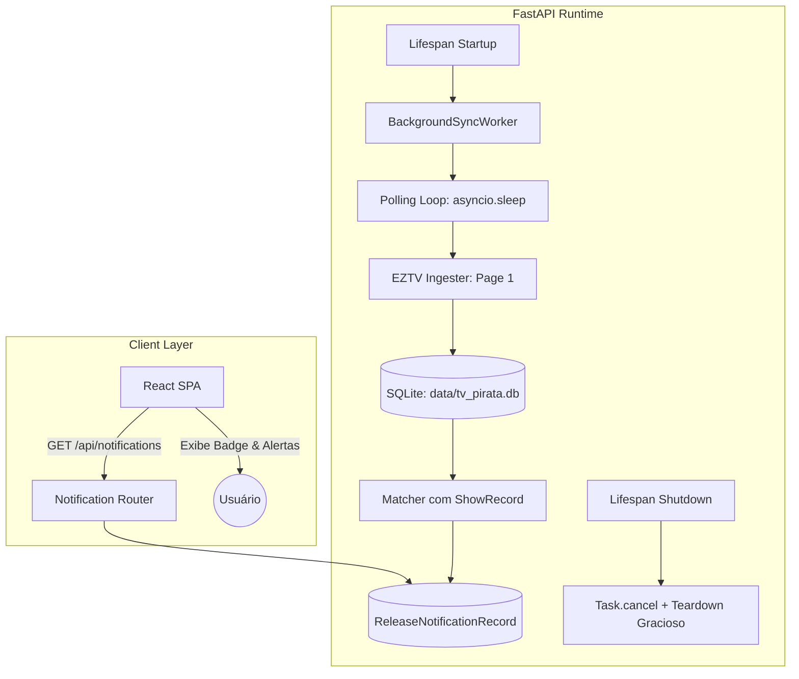
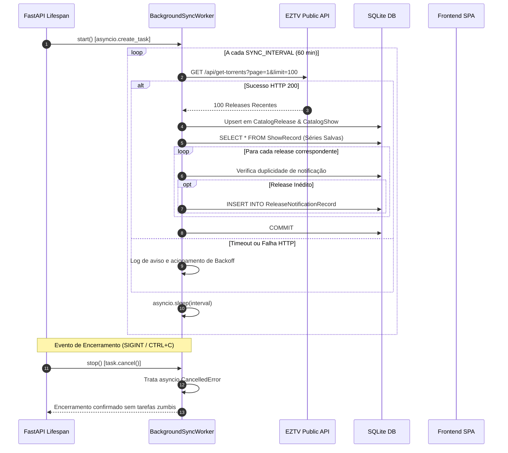

# Blueprint: ADR-007 — Background Auto-Sync, Agendamento Assíncrono e Notificador de Novos Lançamentos

## 1. Visão Arquitetural & Componentes

O subsistema de sincronização em segundo plano opera como um serviço embutido no ciclo de vida da aplicação FastAPI, acionado durante o evento de `lifespan`:



---

## 2. Diagrama de Sequência do Ciclo de Vida e Sincronização



---

## 3. Modelo Relacional e Esquema de Dados

### 3.1 Entidade `ReleaseNotificationRecord` (`src/backend/models/db.py`)

```python
class ReleaseNotificationRecord(SQLModel, table=True):
    """Eventos de notificação para episódios recém-disponibilizados de séries salvas."""

    id: Optional[int] = Field(default=None, primary_key=True)
    show_id: int = Field(foreign_key="showrecord.id", index=True)
    imdb_id: str = Field(index=True)
    show_title: str = Field(default="")
    season: int = Field(default=0, index=True)
    episode: int = Field(default=0, index=True)
    release_title: str = Field(default="")
    quality: str = Field(default="Unknown")
    seeds: int = Field(default=0)
    magnet_url: str = Field(default="")
    is_read: bool = Field(default=False, index=True)
    is_dismissed: bool = Field(default=False, index=True)
    created_at: datetime = Field(default_factory=utc_now, index=True)

    __table_args__ = (
        UniqueConstraint("show_id", "season", "episode", name="uq_notification_episode"),
    )

    show: Optional["ShowRecord"] = Relationship()
```

---

## 4. Contratos de API REST (`src/backend/api/notifications.py`)

### 4.1 Endpoints

1. `GET /api/notifications`:
   - **Query Params:** `unread_only: bool = True`, `limit: int = 50`.
   - **Retorno:** `list[ReleaseNotificationRecord]`.
2. `GET /api/notifications/count`:
   - **Retorno:** `{"unread_count": int}`.
3. `PATCH /api/notifications/{notification_id}/read`:
   - **Retorno:** `ReleaseNotificationRecord` com `is_read = True`.
4. `POST /api/notifications/dismiss-all`:
   - **Retorno:** `{"status": "success", "dismissed_count": int}`.
5. `GET /api/notifications/scheduler-status`:
   - **Retorno:** Telemetria do agendador (`status`, `last_run_at`, `next_run_eta_seconds`, `last_releases_found`, `last_notifications_created`).

---

## 5. Protocolo de Resiliência e Concorrência

1. **Ciclo de Vida Determinístico (Zero Processos Órfãos):**
   - O worker retém uma referência da `asyncio.Task`.
   - No teardown do `lifespan`, executa:
     ```python
     worker_task.cancel()
     try:
         await asyncio.wait_for(worker_task, timeout=5.0)
     except (asyncio.CancelledError, asyncio.TimeoutError):
         logger.info("Worker cancelado com sucesso.")
     ```
2. **Backoff Sob Instabilidade Externa:**
   - Se a requisição à EZTV falhar por timeout de rede ou erro HTTP 5xx, o worker não realiza novas tentativas imediatas; dobra o tempo de espera do ciclo seguinte (até o teto de 120 minutos) e retorna ao intervalo base assim que um ciclo for bem-sucedido.
3. **Isolamento Transacional:**
   - Cada ciclo instancia e fecha uma nova sessão do banco via `Session(engine)`, eliminando sessões abertas duradouras ou locks prolongados no SQLite.
