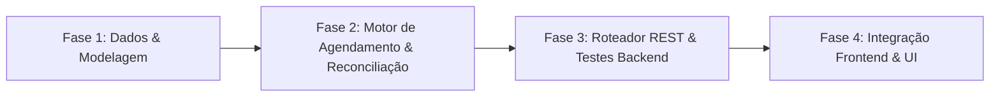

# Plano de Implementação (PI): ADR-007 — Background Auto-Sync e Notificador de Novos Lançamentos

## 1. Faseamento e Dependências

A execução é dividida em 4 fases sequenciais estritas:

### Fase 1: Camada de Dados (T01 - T03)
- Adicionar modelo `ReleaseNotificationRecord`.
- Atualizar migração/inicialização do SQLite via `init_db()`.
- Criar `NotificationRepository` com consultas otimizadas por índice (`is_read`, `created_at`).

### Fase 2: Motor de Agendamento em Segundo Plano (T04 - T06)
- Implementar `BackgroundSyncService` em `src/backend/services/scheduler.py`.
- Configurar rotina assíncrona de polling (`page=1`) com verificação atômica de séries cadastradas em `ShowRecord`.
- Configurar ganchos no `lifespan` do FastAPI em `src/backend/main.py`.

### Fase 3: Roteamento REST e Testes Automatizados (T07 - T09)
- Implementar `/api/notifications` com endpoints de contagem, listagem e marcação de leitura.
- Escrever testes unitários em `tests/unit/test_scheduler.py` cobrindo loop de tempo simulado e cancelamento gracioso.
- Escrever testes de integração em `tests/integration/test_notifications_api.py`.

### Fase 4: Experiência Visual e Reconciliação Frontend (T10 - T12)
- Adicionar tipos e chamadas de API em `types.ts` e `api.ts`.
- Exibir pílula de contador de alertas na `Navbar.tsx`.
- Sinalizar novos lançamentos nos cards da `LibraryView.tsx`.
- Recompilar bundle do frontend via Vite.
- Executar e aprovar quality gate (`make lint`, `make test`, `scripts/quality_gate.sh`).

---

## 2. Estratégia de Rollback

1. **Rollback de Banco de Dados:**
   - A tabela `releasenotificationrecord` é aditiva e isolada por chave estrangeira `showrecord.id`.
   - Se houver falha, remover a tabela com `DROP TABLE releasenotificationrecord` não afeta nenhuma entidade existente.
2. **Rollback do Agendador:**
   - Se o worker causar consumo anômalo de CPU ou instabilidade, basta desativar a flag de inicialização no `lifespan` do `main.py` sem afetar as rotas síncronas existentes.
3. **Rollback de Código:**
   - Reverter commits associados à ADR-007 via `git revert`.

---

## 3. Matriz de Vetores de Teste

| ID | Cenário | Camada | Critério de Sucesso |
| :--- | :--- | :--- | :--- |
| **V01** | Inicialização do FastAPI com o agendador ativo | Integração | O servidor sobe sem bloquear o loop ASGI e a tarefa é instanciada. |
| **V02** | Shutdown do servidor via cancelamento | Unitário | O worker captura `CancelledError` e finaliza em $< 1s$ sem tarefas zumbis. |
| **V03** | Ingestão de release pertencente a série salva | Integração | Criação de registro em `ReleaseNotificationRecord` com dados completos. |
| **V04** | Ingestão de release de série NÃO salva | Integração | O release é persistido no catálogo, mas nenhuma notificação é criada. |
| **V05** | Tentativa duplicada de notificação para mesmo episódio | Unitário | Idempotência garantida; apenas 1 notificação por par `(show_id, season, episode)`. |
| **V06** | Consulta de contagem não lida | Integração | Endpoint `/api/notifications/count` retorna número exato de não lidos. |

