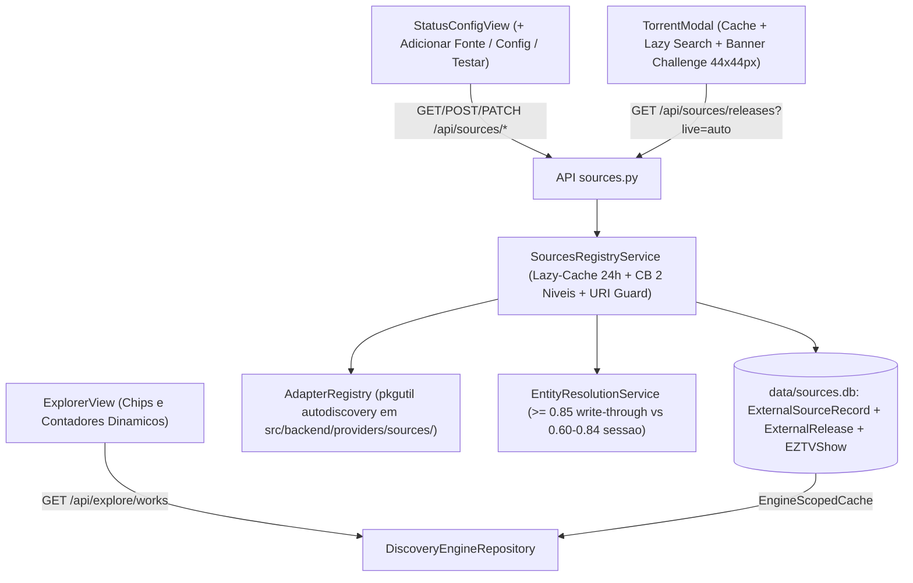

# ADR-013-BP: Blueprint Técnico (`Alt_C_Adapter_1N_Sidecar_LazyCache`)

## 1. Arquitetura C4 de Alto Nível

---

## 2. Especificações Técnicas por Módulo

### 2.1 Separação Adapter vs. Instância & Autodiscovery (`DEC-001`)
1. **Estrutura de Diretório:** `src/backend/providers/sources/`:
   - `__init__.py`: `discover_source_adapters()` varre módulos com `pkgutil.iter_modules`, importa com `try/except Exception` (logando falha diagnóstica em `ADAPTER_LOAD_ERRORS` sem interromper boot do FastAPI).
   - `base.py`: define `BaseSourceAdapter`, `@register_source_adapter`, `AdapterSearchOutcome`, `SourceDiagnostic`, `SyncResult`, `HealthResult`.
   - `eztv_adapter.py`: encapsula ponte legada (`EZTVShow`, `CatalogShow`, `CatalogRelease`, `EZTVIndexerService`) mantendo `eztv_metadata` intacta.
   - `yify_adapter.py`: encapsula YTS v2 (`https://yts.mx/api/v2/list_movies.json`) + `mirrors[]` (`torrent_mirrorable`, suporta `sync()` e `search()` por `imdb_id`/título).
   - `torrent_api_py_adapter.py`: bridge HTTP para API compatível com `Ryuk-me/Torrent-Api-py` (`/api/v1/search?site={site}&query={q}`). Presets sugeridos na UI: `1337x`, `tgx`, `nyaasi`, `piratebay`.
   - `torznab_adapter.py`: cliente `httpx` para feeds Torznab (`/api?t=search|tvsearch|movie&apikey=...&q=...`) suportando Prowlarr e Jackett.
   - `unique_web_adapter.py`: base extensível para fontes web diretas (`unique_web_source`) com detecção de challenge HTTP `403`/`503` + assinaturas Cloudflare/reCAPTCHA/Turnstile retornando `status="challenge_required"` e `challenge_url` segura.

2. **Migração Aditiva em `src/backend/models/sources_db.py` & `database.py` (`RT13-01`):**
   - `ExternalSourceRecord` (`external_sources`) recebe colunas aditivas:
     - `adapter_key: str = Field(default="eztv", index=True)`
     - `source_kind: str = Field(default="torrent_mirrorable")` (`"torrent_mirrorable" | "unique_web_source"`)
     - `config_json: str = Field(default="{}")`
     - `priority: int = Field(default=100, index=True)`
     - `cooldown_until: Optional[datetime] = None`
   - `ExternalRelease` (`external_releases`) recebe colunas aditivas:
     - `matched_by: str = Field(default="exact_imdb")` (`"exact_imdb" | "title_year_match"`)
     - `match_confidence: float = Field(default=1.0)`
     - `last_checked_at: Optional[datetime] = None`
   - `init_eztv_db()` inspeciona colunas via `inspect(active_engine)` e aplica `ALTER TABLE ADD COLUMN` idempotente se faltarem, preenchendo `adapter_key` default (`eztv` -> `eztv`, `yify` -> `yify`, `1337x` -> `torrent_api_py`).

---

### 2.2 Segurança Zero-Trust de URLs & Segredos + Circuit Breaker (`DEC-002`, `DEC-004`)
1. **`validate_safe_url(raw_url, allowed_schemes={"http", "https", "magnet"})`:**
   - Usa `urllib.parse.urlparse`; rejeita `javascript:`, `data:`, `file:`, strings sem host (para `http`/`https`) ou sem prefixo `magnet:?xt=` (para `magnet`), devolvendo `None`. Aplicada na ingestão de `ExternalRelease`, em `challenge_url`, em `config_json.base_url`/`mirrors` e defensivamente no frontend (`TorrentModal.tsx`).
2. **Mascaramento & Preservação de Segredos (`RT13-02`):**
   - Campos marcados com `json_schema_extra={"secret": True}` no `config_schema` do adapter (ex.: `api_key`, `proxy_url`, `auth_token`):
     - Na leitura REST (`GET /api/sources/summary`, `GET /api/sources/adapters`): devolve `{"has_secret": true, "masked": "••••1a2b"}`.
     - Na atualização (`PUT/PATCH /api/sources/{source_key}`): se o valor recebido for `None`, `""`, começar com `"••••"` ou for o objeto mascarado, **preserva o segredo anterior** em `config_json`; só substitui quando um novo valor explícito é enviado.
3. ***Circuit Breaker* em 2 Níveis:**
   - Mapa em memória + persistência em `cooldown_until`:
     - **Nível 1 (Instância):** erro `HTTP >= 400`, parse inválido ou `challenge_required` marca cooldown curto em `source_key` (sem afetar outros sites do mesmo container `Torrent-Api-py`).
     - **Nível 2 (Host Compartilhado):** `httpx.ConnectError` / `TimeoutException` marca cooldown compartilhado (default `120s`) na chave do host (`netloc` normalizado), evitando cascata de timeouts caso o container sidecar `:8009` esteja offline.

---

### 2.3 Motor *Lazy-Cache* (TTL 24h) & Resolução de Identidade (`DEC-003`)
1. **Fluxo `GET /api/sources/releases?imdb_id=...&source=...&live=auto|cache|force&q_override=...`:**
   - Consulta imediatamente `ExternalRelease` + `CatalogRelease` em `data/sources.db`.
   - Para cada instância habilitada com `supports_search=True`:
     - Se `live=cache`: usa apenas banco.
     - Se `live=force` OU (`live=auto` e sem cache válido dentro de `ttl_hours=24` via `last_checked_at`): dispara `adapter.search(...)` em paralelo (`asyncio.gather` com timeout por instância).
     - **Se responder `ok`:** executa `EntityResolutionService` para itens sem `imdb_id`:
       - Score `>= 0.85` (ou `imdb_id` idêntico) → grava/atualiza `ExternalRelease` (`last_checked_at = utc_now()`, `matched_by`, `match_confidence`), invalida `discovery_cache` para acender `MediaBadge`.
       - Score `0.60 – 0.84` → retornado **somente na resposta da sessão** em `approx_matches` (sem persistir em `ExternalRelease` e sem acender `MediaBadge`).
     - **Se falhar / cooldown / timeout:** mantém releases cacheados expirados visíveis como *fallback offline* e registra diagnóstico em `source_diagnostics`.
2. **Payload Estendido (`SourceReleasesResponse` — retrocompatível):**
   - Mantém `imdb_id`, `total`, `available_sources`, `by_source`, `items` intactos e **adiciona**:
     - `approx_matches: list[SourceReleaseItem]` (`match_confidence` entre `0.60` e `0.84`)
     - `source_diagnostics: Record<string, { status, message?, challenge_url?, cached_at?, from_cache?, latency_ms? }>`

---

### 2.4 Novos Endpoints `/api/sources/*` & Deshardcoding (`DEC-005`)
- `GET /api/sources/adapters` -> lista adapters descobertos + seus `json_schema` (para montar formulário dinâmico).
- `POST /api/sources` -> cria nova instância em `external_sources` validada pelo `config_schema` do `adapter_key` e invalida caches.
- `PATCH /api/sources/{source_key}` -> atualiza `enabled`, `priority`, `source_kind`, `config_json` (preservando segredos sentinel) e invalida caches.
- `DELETE /api/sources/{source_key}` -> remove instâncias customizadas (protege fonte base `eztv` contra deleção acidental).
- `POST /api/sources/{source_key}/test` -> executa `adapter.healthcheck(instance)` e retorna latência/diagnóstico em tempo real.
- **Deshardcoding Backend/Frontend:**
  - `DiscoveryEngineRepository._query_imdb_catalog_sql` e `_build_imdb_facets` param de listar explicitamente `"yify"`, `"1337x"` e passam a iterar dinamicamente sobre qualquer `src_key` presente em `media_sources_by_imdb` / `external_sources`.
  - `ExplorerView.tsx` gera os botões da seção **"Fontes de Dados & Provedores"** combinando metadados canônicos estáticos (`imdb`, `tmdb`, `ptbr`, etc.) com a lista viva vinda de `GET /api/sources/summary` (`enabled === true` ou `total_releases > 0`) + atalho agregado `"media"` (*Com Mídia — Qualquer Fonte*).

---

### 2.5 Contratos de UI (`StatusConfigView.tsx` & `TorrentModal.tsx`)
- **`StatusConfigView.tsx`:**
  - Lista instâncias em cards expansíveis (`enabled`, prioridade, `source_kind`, `mirrors[]`, formulário dinâmico tipado por `config_schema`, mascaramento visual de segredos, botão **"Testar Conexão"** e exclusão segura de instâncias extras).
  - Modal/drawer **"+ Adicionar Fonte"**: escolhe `adapter_key` (ex.: `Torrent-Api-py`, `Torznab`, `Unique Web`), preenche campos com validação e salva via `POST /api/sources`.
- **`TorrentModal.tsx`:**
  - Abre instantaneamente com cache + indicador discreto de carregamento ao vivo; inclui botão **"Buscar Ao Vivo"** (`live=force`) + campo editável de busca manual para refinar query na fonte.
  - Quando `source_diagnostics[key].status === "challenge_required"`, exibe badge âmbar na aba e banner com link validado (`http/https`) em botão `44×44px` **"Abrir Página no Navegador"** + botão **"Tentar Novamente"**.
  - Renderiza `approx_matches` em seção separada com tag **"Correspondência aproximada (não salva)"**.
