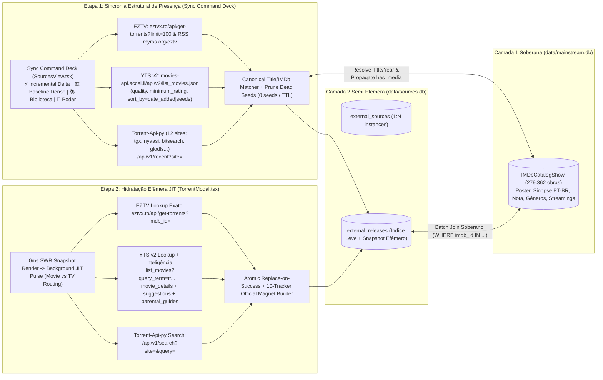

# ADR-014-BP: Blueprint Técnico

## 1. Arquitetura de Sincronia Bipartida em 2 Etapas (Camada 1 Soberana + Camada 2 Semi-Efêmera)

---

## 2. Especificações de Componentes por Decisão (`DEC-001`..`DEC-006`)

### 2.1. `DEC-001` — `YIFYSourceAdapter` (`movies-api.accel.li/api/v2/`) & `build_official_magnet`
- **Arquivo `src/backend/providers/sources/base.py`:**
  - `OFFICIAL_YTS_TRACKERS: list[str]` contendo exatamente os 10 trackers de `sources-apis.md` (`#L239-L248`):
    1. `udp://tracker.opentrackr.org:1337/announce`
    2. `udp://tracker.torrent.eu.org:451/announce`
    3. `udp://tracker.dler.org:6969/announce`
    4. `udp://open.stealth.si:80/announce`
    5. `udp://open.demonii.com:1337/announce`
    6. `https://tracker.moeblog.cn:443/announce`
    7. `udp://open.dstud.io:6969/announce`
    8. `udp://tracker.srv00.com:6969/announce`
    9. `https://tracker.zhuqiy.com:443/announce`
    10. `https://tracker.pmman.tech:443/announce`
  - `build_official_magnet(info_hash: str, title: str, trackers: list[str] | None = None) -> str`: usa `urllib.parse.quote_plus(title.strip())` para `dn=` e anexa `&tr=...` para cada tracker.
  - `parse_release_title_and_year(raw_title: str) -> tuple[str, int | None, str]`: extrai `(clean_title, release_year, detected_quality)` de nomes brutos de torrents (`S01E02`, `2024`, `2160p`, `1080p`, `WEB-DL`, `x265`).
- **Arquivo `src/backend/providers/sources/yify_adapter.py`:**
  - `DEFAULT_YTS_BASE_URL = "https://movies-api.accel.li/api/v2/list_movies.json"`
  - `DEFAULT_YTS_API_ROOT = "https://movies-api.accel.li/api/v2"`
  - `YTS_MIRRORS = ["https://yts.gg/api/v2/list_movies.json", "https://yts.mx/api/v2/list_movies.json", "https://yts.lt/api/v2/list_movies.json"]`
  - `sync(config, pages, limit_per_page)` aceita parâmetros opcionais de receita em `config` (`sync_mode`, `quality`, `minimum_rating`, `genre`, `sort_by`, `order_by`, `with_rt_ratings=True`). Em modo `incremental`, usa `sort_by="date_added"`; em modo `baseline`, usa `sort_by=config.get("sort_by", "seeds")`.
  - `fetch_movie_enrichment(config, imdb_id=None, movie_id=None) -> dict[str, Any]`:
    1. Se `movie_id` não for informado, descobre-o via `list_movies.json?query_term={imdb_id}&limit=1&with_rt_ratings=true`.
    2. Consulta concorrentemente (`asyncio.gather` com `timeout=4.0s`):
       - `movie_details.json?movie_id={yts_id}&with_images=true&with_cast=true`
       - `movie_suggestions.json?movie_id={yts_id}`
       - `movie_parental_guides.json?movie_id={yts_id}`
    3. Retorna payload estruturado `{movie_id, imdb_id, description_full, yt_trailer_code, runtime, rating, rt_Ratings, cast, parental_guides: [{type, parental_guide_text}], suggestions: [{id, imdb_code, title, year, rating, medium_cover_image, qualities}]}`.

### 2.2. `DEC-002` — `EZTVSourceAdapter` (`eztvx.to/api/get-torrents`, RSS `myrss.org/eztv` & `eztvstatus.org`)
- **Arquivo `src/backend/providers/sources/eztv_adapter.py` & `src/backend/providers/eztv.py`:**
  - `DEFAULT_EZTV_API_URL = "https://eztvx.to/api/get-torrents"`
  - `DEFAULT_EZTV_RSS_URL = "https://myrss.org/eztv"`
  - `DEFAULT_EZTV_STATUS_URL = "https://eztvstatus.org/"`
  - Em `search()` e `healthcheck()`, normalizar `numeric_imdb = re.sub(r"\D", "", str(imdb_id or ""))` para garantir que `?imdb_id=6048596` nunca envie o prefixo `tt` e que `limit` respeite a faixa `1..100` e `page` `1..100`.
  - Adicionar `fetch_rss_items(rss_url, timeout)` parseando o XML RSS oficial (`<item><title>`, `<link>`, `<torrent:magnetURI>` / `<enclosure>`) como canal de pulso rápido incremental.

### 2.3. `DEC-003` — `TorrentApiPySourceAdapter` (12 Provedores + Dual-Mode `/recent` & `/search`)
- **Arquivo `src/backend/providers/sources/torrent_api_py_adapter.py`:**
  - `supports_sync = True`, `supports_search = True`.
  - `SITE_CATALOG: dict[str, dict[str, Any]]` com os **12 sites** do `Ryuk-me/Torrent-Api-py`:
    - `tgx`: TorrentGalaxy (`https://torrentgalaxy.to`, `tier="recommended"`, `media_types=["movies", "tv"]`)
    - `nyaasi`: Nyaa.si (`https://nyaa.si`, `tier="recommended"`, `media_types=["anime", "animation", "tv", "movies"]`)
    - `bitsearch`: BitSearch (`https://bitsearch.to`, `tier="recommended"`, `media_types=["movies", "tv"]`)
    - `glodls`: GloDLS (`https://glodls.to`, `tier="recommended"`, `media_types=["movies", "tv"]`)
    - `magnetdl`: MagnetDL (`https://www.magnetdl.com`, `tier="extended"`, `media_types=["movies", "tv"]`)
    - `limetorrent`: LimeTorrents (`https://www.limetorrents.lol`, `tier="extended"`, `media_types=["movies", "tv"]`)
    - `torlock`: Torlock (`https://www.torlock.com`, `tier="extended"`, `media_types=["movies", "tv", "anime"]`)
    - `kickass`: KickassTorrents (`https://kickasstorrents.to`, `tier="extended"`, `media_types=["movies", "tv"]`)
    - `zooqle`: Zooqle (`https://zooqle.com`, `tier="extended"`, `media_types=["movies", "tv"]`)
    - `yts`: YTS via Sidecar (`https://movies-api.accel.li`, `tier="extended"`, `media_types=["movies"]`)
    - `1337x`: 1337x (`https://1337x.to`, `tier="legacy_cloudflare"`, `media_types=["movies", "tv"]`)
    - `piratebay`: ThePirateBay (`https://thepiratebay.org`, `tier="legacy_cloudflare"`, `media_types=["movies", "tv"]`)
  - `sync(config, pages, limit_per_page)`: chama `GET {base_url}/api/v1/recent?site={site}&limit={limit_per_page}&page={p}` (com fallback gracioso para `/api/v1/search?site={site}&query=1080p` caso um site específico do sidecar não implemente `/recent`), aplicando `parse_release_title_and_year` e `build_official_magnet` quando `magnet` não contiver trackers.
  - `DEFAULT_SOURCE_INSTANCES` em `sources_registry.py`: `eztv`, `yify` (`movies-api.accel.li`), `tgx`, `nyaasi`, `bitsearch`, `glodls`.
  - Migração idempotente em `ensure_sources_registered()`:
    - Atualiza `yify.base_url` e `config_json.base_url` de `yts.mx`/`yts.gg` para `https://movies-api.accel.li/api/v2/list_movies.json`.
    - Semeia `tgx`, `nyaasi`, `bitsearch` e `glodls` caso ausentes, e caso `1337x` esteja com `0 releases` do seed anterior, substitui/desativa-o em favor do quarteto resiliente.

### 2.4. `DEC-004` — Sincronia Bipartida Etapa 1 (`incremental`, `baseline`, `library`, `prune`)
- **Em `SourcesRegistryService` (`src/backend/services/sources_registry.py`):**
  - `_resolve_imdb_id_against_mainstream(title: str, release_year: int | None) -> str | None`: consulta `IMDbCatalogShow` em `data/mainstream.db` (via `shows_fts` ou match exato de `title`/`original_title` + `compute_title_match_confidence >= 0.85`) para vincular releases da Etapa 1 ao `imdb_id` soberano.
  - `prune_obsolete_releases(source_key: str | None = None, min_seeds_floor: int = 1, max_zero_seed_hours: int = 48, max_stale_days: int = 14) -> dict[str, Any]`:
    - Remove de `external_releases` registros onde `(seeds < min_seeds_floor AND last_checked_at <= cutoff_zero_seed)` ou `last_checked_at <= cutoff_stale`.
    - Recalcula `total_titles` e `total_releases` em `ExternalSourceRecord` e propaga flags para `mainstream.db`.
  - `sync_source(source_key, pages=2, limit_per_page=35, mode="incremental", quality="", minimum_rating=0, sort_by="", min_seeds_floor=1, prune_after=True)`:
    - Suporta `mode="incremental"`, `mode="baseline"`, `mode="library"` (itera sobre os títulos salvos em `ShowRecord` da biblioteca pessoal em `mainstream.db` e hidrata suas presenças nas fontes ativas) e `mode="prune"`.

### 2.5. `DEC-005` — Sincronia Bipartida Etapa 2 (JIT SWR + Format Routing + `Replace-on-Success` + Inteligência YTS)
- **Em `SourcesRegistryService.get_releases_for_imdb`:**
  - Aceita `media_format: str | None = None` (`"movie"`, `"tv_show"`, `"animation"`, etc. — auto-detectado de `IMDbCatalogShow.work_type`/`genres` em `mainstream.db` se omitido).
  - **Roteamento Inteligente por Formato (`RT14-03`):**
    - Se a obra for exclusivamente `tv_show`/`mini_series`, pula `yify` (`media_types == ["movies"]`).
    - Se a obra for exclusivamente `movie`, pula `eztv` (`media_types == ["tv"]`).
  - **Transação `Replace-on-Success` (`RT14-01`):**
    - Quando `adapter.search(...)` retorna `diag.status == "ok"` com pelo menos 1 match de alta confiança (`>= 0.85`), substitui os releases antigos daquele `(src.source_key, norm_imdb)` que não vieram no lote vivo ou caíram para `0 seeds`, preservando o snapshot anterior intacto caso a fonte retorne `timeout`/`cooldown`/`error`.
  - **Endpoint `GET /api/sources/yify/enrichment/{imdb_id}` (e campo `yify_intelligence` opcional em `/api/sources/releases/{imdb_id}`):**
    - Retorna `parental_guides`, `suggestions` (cruzadas com `mainstream.db` quando possível) e `movie_details` do YTS v2 (`movies-api.accel.li`).

### 2.6. `DEC-006` — Batch Join Soberano (`mainstream.db`) & Sync Command Deck (`SourcesView.tsx`)
- **Em `SourcesRegistryService.list_catalog`:**
  - Quando `source == "all"`, deduplica títulos com o mesmo `imdb_id` entre `EZTVShow`, `CatalogShow` e `ExternalRelease`, agregando `media_sources: list[str]`, `qualities: list[str]`, `max_seeds: int` e `total_torrents: int`.
  - Executa **Batch Sovereign Hydration**: coleta os `imdb_id`s da página (`<= 24` itens) e faz 1 única query indexada em `data/mainstream.db` (`SELECT * FROM shows WHERE imdb_id IN (...)`), preenchendo `poster_url`, `backdrop_url`, `overview` (priorizando `synopsis_ptbr`), `rating` (`imdb_rating`), `genres`, `status`, `network` e `streaming_providers`.
- **Em `SourcesView.tsx`:**
  - **Sync Command Deck**:
    - Pílulas de Receita de 1 clique:
      1. `⚡ Incremental Delta (Novidades + Poda)`
      2. `🏗️ Baseline Top Seeds`
      3. `💎 4K / 1080p Nota 7+`
      4. `📚 Sincronizar Minha Biblioteca`
      5. `🧹 Podar Obsoletos (0 Seeds)`
    - Botão `Ajuste Fino` expandindo seletores de `Qualidade` (`All`, `2160p`, `1080p`, `1080p.x265`, `720p`), `Nota Mínima IMDb` (`0..8`), `Ordenação na Fonte` (`date_added`, `seeds`, `download_count`, `rating`) e `Páginas` (`1..10`).
  - **Onda Card a Card (`2A`) & Cards Cockpit (`9D`):**
    - Ao acionar uma receita para `"Todas as Fontes"`, a UI executa a onda card por card, exibindo em cada card de provedor seu status orbital (`Colhendo...` $\rightarrow$ `+N novos • M podados` ou `Sidecar :8009 Offline (Pulado)`), botão individual `⚡` (`44×44px`), pílulas de qualidade e badge de protocolo (`accel.li v2`, `eztvx.to + RSS`, `Sidecar :8009`).
  - **Search-to-Catalog Live Trigger (`4D`):**
    - Na barra de busca de `SourcesView.tsx`, exibe botão **`⚡ Buscar & Ingerir "<termo>" ao Vivo`** que aciona busca federada nas fontes ativas, persiste matches `>= 0.85` e recarrega a grade instantaneamente.
