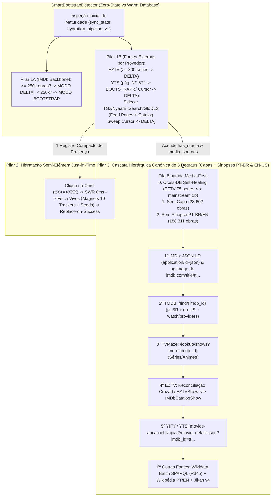

# ADR-015-BP: Blueprint Técnico

## 1. Arquitetura dos 3 Pilares de Hidratação & Gatilho Inteligente de Maturidade



---

## 2. Especificações Técnicas por Decisão (`DEC-001`..`DEC-006`)

### 2.1. `DEC-001` — `SmartBootstrapDetector` & Esquema de Checkpoint `hydration_pipeline_v1`
Armazenado na tabela `sync_state` de `data/mainstream.db` sob a chave `hydration_pipeline_v1`:
```json
{
  "schema_version": 1,
  "is_running": false,
  "active_scope": "all",
  "started_at": null,
  "updated_at": "2026-11-19T22:50:00Z",
  "pillar_1a_imdb": {
    "lifecycle_mode": "delta",
    "bootstrap_completed": true,
    "total_titles": 279362,
    "total_episodes": 4529748
  },
  "pillar_1b_sources": {
    "eztv": {"lifecycle_mode": "delta", "bootstrap_completed": true, "next_page": 1, "total_titles": 860},
    "yify": {"lifecycle_mode": "bootstrap", "bootstrap_completed": false, "next_page": 6, "total_pages": 1572, "total_titles": 251},
    "tgx": {"lifecycle_mode": "bootstrap", "bootstrap_completed": false, "next_page": 2, "catalog_sweep_offset": 0, "total_titles": 33},
    "nyaasi": {"lifecycle_mode": "bootstrap", "bootstrap_completed": false, "next_page": 2, "catalog_sweep_offset": 0, "total_titles": 7},
    "bitsearch": {"lifecycle_mode": "bootstrap", "bootstrap_completed": false, "next_page": 2, "catalog_sweep_offset": 0, "total_titles": 17},
    "glodls": {"lifecycle_mode": "bootstrap", "bootstrap_completed": false, "next_page": 2, "catalog_sweep_offset": 0, "total_titles": 25}
  },
  "pillar_3_waterfall": {
    "missing_posters_remaining": 23602,
    "missing_synopsis_remaining": 188311,
    "eztv_unhydrated_remaining": 75,
    "total_hydrated_session": 0,
    "provenance_counts": {
      "imdb": 0,
      "tmdb": 0,
      "tvmaze": 0,
      "eztv": 0,
      "yify": 0,
      "other_open": 0
    }
  }
}
```
- **Regra do Gatilho Inteligente (`evaluate_maturity`):**
  - Se `mainstream.db` tiver `< 10.000` obras $\rightarrow$ `pillar_1a_imdb.lifecycle_mode = "bootstrap"`. Caso contrário (`>= 10.000` obras, como as `279.362` atuais) $\rightarrow$ `lifecycle_mode = "delta"`, `bootstrap_completed = True`.
  - Se `EZTVShow` em `sources.db` tiver `>= 500` séries (como as `860` atuais) $\rightarrow$ `eztv.lifecycle_mode = "delta"`, `bootstrap_completed = True`.
  - Para `yify` e provedores do Sidecar (`tgx`, `nyaasi`, `bitsearch`, `glodls`): permanecem em `lifecycle_mode = "bootstrap"` enquanto `bootstrap_completed == False`, avançando seus cursores `next_page` e `catalog_sweep_offset` a cada passo do orquestrador até cobrir o catálogo alvo, momento em que chaveiam automaticamente para `lifecycle_mode = "delta"`.

### 2.2. `DEC-002` & `DEC-003` — Pilar 1B: Cursores Progressivos, `Canonical Catalog Anchor Sweep` & Presença Compacta (`Batch UPSERT`)
1. **`YIFYSourceAdapter.sync(..., start_page: int = 1, compact_presence: bool = True)`:**
   - Quando `mode == "baseline"`, lê `start_page` do cursor persistente (`next_page` em `config_json` / `hydration_pipeline_v1`) e varre `start_page .. start_page + pages - 1`.
   - Extrai `movie_count` do payload da YTS API v2 (`78.565` filmes $\rightarrow$ `total_pages = ceil(movie_count / 50)`), salva `next_page = end_page + 1` no `config_json` da instância e marca `bootstrap_completed = True` quando `next_page > total_pages`.
   - **Batch Presence UPSERT (`compact_presence=True`):** Faz 1 única query `SELECT ... WHERE source_key = 'yify' AND external_id IN (...)` por página de 50 filmes e grava 1 registro compacto de presença por filme (`external_id = f"yts:presence:{imdb_id}"`, `quality = ",".join(sorted_qualities)`, `seeds = max_seeds`, `magnet_url = best_magnet`), reduzindo o tempo de escrita para `< 15ms` por página! Quando o usuário abre o modal do filme (**Pilar 2 — JIT**), `get_releases_for_imdb` com `Replace-on-Success` substitui o registro resumo pelas linhas individuais de cada qualidade (`2160p`, `1080p.x265`, `1080p`, `720p`) com os 10 trackers oficiais!
2. **`TorrentApiPySourceAdapter` (`tgx`, `nyaasi`, `bitsearch`, `glodls` — Paginação Profunda + `Catalog Anchor Sweep`):**
   - **Expansão Multi-Página / Multi-Categoria em `_fetch_native_direct_items(site, query, limit, page)`:**
     - `tgx` (`therarbg.to`): suporta `?page={page}` real (`page=1..50`) tanto em `category:Movies` quanto em `category:TV`, retornando `50` itens por página com `imdb_id` (`i="tt..."`) nativo!
     - `glodls` (`apibay.org`): varre todas as **6 categorias precompiladas de vídeo** (`data_top100_201.json` Filmes, `202` DVDR, `205` Séries TV, `207` Filmes HD, `208` Séries HD, `209` 3D = até `600` releases por varredura!) + busca paginada `q.php?q={year_or_title}`.
     - `bitsearch` (`bitsearch.to`): suporta paginação real `?q={term}&page={page}` varrendo páginas e safras anuais (`2026`, `2025`, `2024`, `2023`, `2022`, `2021`, `2020`, `1080p`, `2160p`).
     - `nyaasi` (`nyaa.si`): varre RSS de `75` itens (`c=1_2` Anime English-translated) + busca direcionada pelo `Canonical Catalog Anchor Sweep` de animes!
   - **Canonical Top-Catalog Anchor Sweep (`sweep_canonical_catalog_presence`):**
     - A cada ciclo de bootstrap de uma fonte do Sidecar, além de avançar `next_page` do feed da fonte, o motor seleciona o próximo lote (`catalog_sweep_offset .. +batch_size`) das obras mais votadas de `mainstream.db` compatíveis com a fonte (para `nyaasi`: obras com `genres LIKE '%Animation%'` ou `countries LIKE '%JP%'` ou `genres_ptbr LIKE '%Animação%'`; para `tgx`/`bitsearch`/`glodls`: top filmes e séries por `rating_votes DESC`), consulta a fonte e grava o vínculo de presença em `sources.db`!

### 2.3. `DEC-004` & `DEC-005` — Pilar 3: Cascata Hierárquica Canônica de 6 Degraus (`CascadingMetadataEnricher`)
Arquivo: `src/backend/services/cascading_enricher.py`.

Para cada lote de obras com metadados incompletos (`poster_url` ausente, `synopsis_ptbr` ausente ou `synopsis` EN-US ausente), o enriquecedor reconcilia os atributos na **ordem hierárquica estrita de prioridade**:

1. **Degrau 1 — `IMDb` (Backbone Canônico + Extrator Público JSON-LD / OpenGraph `imdb.com/title/{imdb_id}/`):**
   - Preserva os campos soberanos já existentes no Backbone IMDb (`primary_title`, `original_title`, `start_year`, `runtime_minutes`, `rating_score`, `rating_votes`, `genres`).
   - Quando a obra não possui `poster_url` ou `synopsis` (`EN-US`), consulta `https://www.imdb.com/title/{imdb_id}/` com headers HTTP seguros, extrai o bloco `<script type="application/ld+json">` (e meta tags `og:image` / `og:description`) e obtém:
     - `poster_url` (`ld["image"]` oficial em alta definição da Amazon/IMDb media CDN);
     - `synopsis` (`EN-US`: `html.unescape(ld["description"])`);
     - `content_rating` (`ld["contentRating"]`);
     - `trailer_url` (`ld["trailer"]["embedUrl"]` quando presente);
     - `directors` / `cast_members` (se ausentes).
2. **Degrau 2 — `TMDB` (`/find/{imdb_id}?external_source=imdb_id` + `pt-BR` + `en-US` + `watch/providers`):**
   - Quando `TMDB_API_KEY` / Bearer Token estiver configurado, consulta `pt-BR` (para `title_ptbr`, `synopsis_ptbr`, `poster_url`, `backdrop_url`, `trailer_url`, `streaming_providers` BR/US) e `en-US` (caso `synopsis` em inglês ainda esteja vazia).
   - Respeita a hierarquia: se o Degrau 1 (`IMDb`) já preencheu `poster_url` ou `synopsis` (`EN-US`), o TMDB complementa os campos que ainda estiverem vazios (especialmente `synopsis_ptbr`, `title_ptbr`, `backdrop_url` e `streaming_providers`).
3. **Degrau 3 — `TVMaze` (`https://api.tvmaze.com/lookup/shows?imdb={imdb_id}`):**
   - Para séries (`tvSeries`, `tvMiniSeries`), preenche lacunas remanescentes de `poster_url` (`image.original` / `image.medium`), `synopsis` (`EN-US`, limpando tags HTML `<p>`), `status`, `network` (`network.name` / `webChannel.name`) e `tvmaze_id`.
4. **Degrau 4 — `EZTV` (`Cross-DB Self-Healing` Bidirecional `sources.db` $\leftrightarrow$ `mainstream.db`):**
   - Sincroniza mutuamente `EZTVShow` (`data/sources.db`) e `IMDbCatalogShow` (`data/mainstream.db`) pelo `imdb_id` normalizado (e fallback por slug/título exato):
     - Se `EZTVShow` tiver `poster_url`, `synopsis`, `network`, `status` ou `streaming_providers` que faltam em `IMDbCatalogShow`, copia para `IMDbCatalogShow`;
     - Se `IMDbCatalogShow` (já enriquecido pelos Degraus 1–3) tiver `poster_url`, `synopsis_ptbr`/`synopsis`, `rating_score`, `network`, `status` ou `genres` que faltam nas `75` séries órfãs de `EZTVShow` (`guide_synced = -1`), cura imediatamente `EZTVShow` em `data/sources.db`!
5. **Degrau 5 — `YIFY / YTS` (`https://movies-api.accel.li/api/v2/movie_details.json?imdb_id={imdb_id}&with_images=true&with_cast=true`):**
   - Para filmes (`movie`, `tvMovie`) que ainda tenham lacunas de `poster_url`, `backdrop_url`, `synopsis` (`EN-US`), `trailer_url` ou `cast_members`, consulta a API oficial v2 do YTS e preenche `large_cover_image`, `background_image_original`, `description_full`, `https://www.youtube.com/watch?v={yt_trailer_code}` e `mpa_rating`.
6. **Degrau 6 — `Outras Fontes Abertas` (`Wikidata Batch SPARQL P345 + Wikipédia PT-BR / EN-US REST Summary` & `Jikan v4 / MyAnimeList`):**
   - **6A — Wikidata Batch SPARQL (`https://query.wikidata.org/sparql`) + Wikipédia REST API:**
     - Resolve até `40` `imdb_id`s de uma só vez via `VALUES ?imdb { "tt..." }`, obtendo `label_pt`, `label_en`, artigo `ptwiki_title` (`https://pt.wikipedia.org/api/rest_v1/page/summary/{title}` $\rightarrow$ `synopsis_ptbr` e `thumbnail.source`), artigo `enwiki_title` (`https://en.wikipedia.org/api/rest_v1/page/summary/{title}` $\rightarrow$ `synopsis` EN-US) e imagem `P18` do Wikimedia Commons.
   - **6B — Jikan v4 / MyAnimeList (`https://api.jikan.moe/v4/anime?q={title}&limit=1`):**
     - Para animações/animes ainda com lacunas de capa ou sinopse, obtém `images.jpg.large_image_url`, `synopsis` (`EN-US`), `studios` e `trailer.url`.

### 2.4. `DEC-006` — Worker Cooperativo (`HydrationOrchestratorService`), Rotas REST, CLI `--resume` & Console UI
- **Arquivo `src/backend/services/hydration_orchestrator.py`:**
  - Gerencia a `asyncio.Task` em background com `start(scope="all" | "sources" | "metadata")`, `pause()`, `run_single_step(scope="all")`, `reset_cursor(source_key)` e `get_status()`.
  - Respeita `stop(timeout=3.0)` no `lifespan` de `src/backend/main.py` (Zero Processos Órfãos).
- **Rotas em `src/backend/api/explore.py`:**
  - `GET /api/explore/hydration/status`: retorna o estado completo dos 3 pilares, maturidade (`delta` vs `bootstrap`), cursores por fonte, lacunas restantes (`missing_posters_remaining`, `missing_synopsis_remaining`, `eztv_unhydrated_remaining`) e contadores de proveniência (`imdb`, `tmdb`, `tvmaze`, `eztv`, `yify`, `other_open`).
  - `POST /api/explore/hydration/start?scope=all`: inicia/retoma o worker contínuo em background a partir do último checkpoint.
  - `POST /api/explore/hydration/pause`: sinaliza pausa cooperativa imediata salvando o checkpoint.
  - `POST /api/explore/hydration/step?scope=all`: executa 1 ciclo determinístico (ideal para avanço imediato e testes herméticos `pytest`).
  - `POST /api/explore/hydration/reset-cursor?target=yify`: reseta o cursor de bootstrap de uma fonte específica.
- **Script CLI `scripts/hydrate_ecosystem.py` & `Makefile` (`make hydrate`):**
  - Permite rodar `.venv/bin/python scripts/hydrate_ecosystem.py --resume --scope all --max-steps 50` no terminal compartilhando o mesmo estado `hydration_pipeline_v1`.
