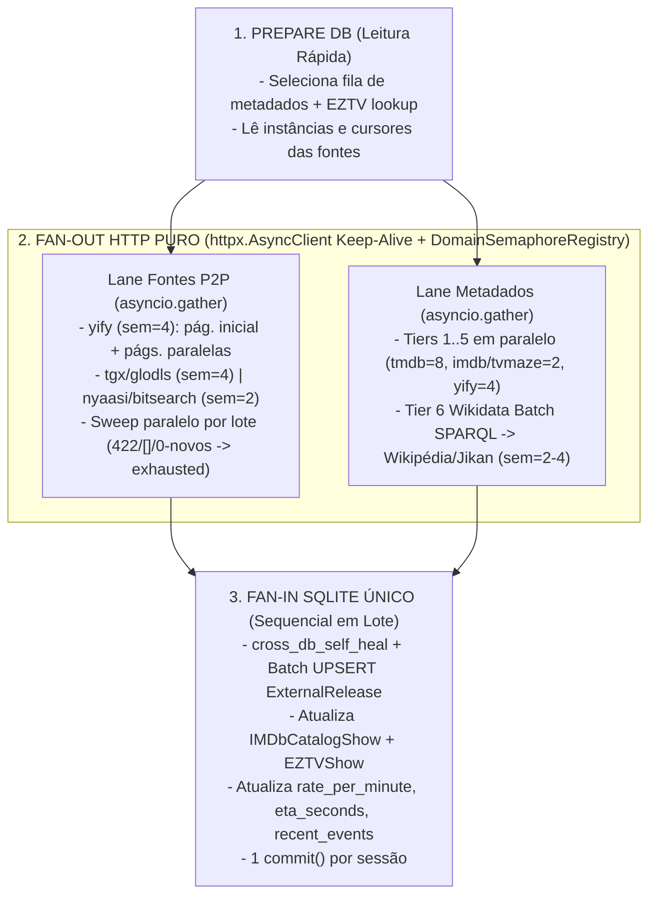

# ADR-017-BP: Blueprint Técnico

## 1. Fluxo Bifurcado em 3 Fases

---

## 2. Especificações Técnicas por Decisão (`DEC-001`..`DEC-005`)

### 2.1. `DEC-001` — Correção `422` & Exaustão Determinística
- **`src/backend/sidecar/torrent_api_sidecar.py`:** Remover teto artificial `le=20` em `get_recent_torrents` (`page: int = Query(1, ge=1)`), retornando `data: []` quando `page > 20` ou quando o provedor não tiver mais páginas.
- **`src/backend/providers/sources/torrent_api_py_adapter.py`:** Em `fetch_recent_candidates`, se `resp.status_code == 422` (compatibilidade com sidecars externos com `le=20`), encerrar o loop de páginas retornando os candidatos já coletados (`[]` se na página atual) sem lançar erro.
- **`src/backend/services/sources_registry.py`:** Em `sync_source`, durante `mode == "baseline"` e `start_page > 1`, se `recent_cands` vier vazio **ou** se `indexed == 0` (100% itens duplicados já existentes no banco), marcar `telemetry["exhausted"] = True` para ativar imediatamente `recent_exhausted = True` e migrar para `sweep_canonical_catalog_presence`.

### 2.2. `DEC-002` — `DomainSemaphoreRegistry` & Keep-Alive
Novo módulo leve `src/backend/core/domain_concurrency.py`:
- `WeakKeyDictionary[asyncio.AbstractEventLoop, dict[str, asyncio.Semaphore]]` isolado por loop ativo (garantia total contra `RuntimeError: attached to a different loop` em `pytest` e `uvicorn --reload`).
- Limites padrão configuráveis:
  `tmdb=8`, `yify=4`, `tgx=4`, `glodls=4`, `sidecar=4`, `wikipedia=4`, `nyaasi=2`, `bitsearch=2`, `imdb=2`, `tvmaze=2`, `jikan=2`, `wikidata=2`.
- Pool HTTP compartilhado por ciclo:
  `httpx.AsyncClient(timeout=timeout, follow_redirects=True, limits=httpx.Limits(max_connections=32, max_keepalive_connections=16))`.

### 2.3. `DEC-003` — Execução 3-Fases sem Contenção SQLite
- **Nenhuma corrotina dentro de `asyncio.gather` escreve em `Session`.**
- `YIFYSourceAdapter`: busca `start_page` primeiro (captura `total_pages`), depois dispara `range(start_page + 1, min(total_pages, start_page + pages - 1) + 1)` via `asyncio.gather` sob semáforo `yify`, e faz `Batch SELECT/UPSERT` único ao final.
- `SourcesRegistryService.sweep_canonical_catalog_presence`: dispara as consultas `adapter.search(...)` dos `batch_size` títulos em paralelo via `asyncio.gather(..., return_exceptions=True)` limitado pelo semáforo do site, e persiste os matches verificados no Fan-in.
- `CascadingMetadataEnricher`: separa `_fetch_metadata_network(...)` (HTTP puro para Tiers 1–5 + Tier 6 batch) do Fan-in (`cross_db_self_heal` + `_apply_coalesce` + commits).
- `HydrationOrchestratorService.run_single_step`: quando `scope == "all"`, executa a coleta HTTP das fontes (`tgx`, `nyaasi`, `bitsearch`, `glodls`, `yify`) e dos metadados em paralelo com `return_exceptions=True`, consolidando todas as gravações no Fan-in.

### 2.4. `DEC-004` & `DEC-005` — Lotes, Telemetria Multi-Faixa & Sidecar CLI
- Defaults padrão em `run_single_step` e `explore.py`: `yts_pages=6`, `sweep_batch=12`, `meta_batch=20`.
- `current_target`: resumo multi-faixa legível durante execução paralela.
- `Makefile`: `run-sidecar` suporta `--workers 4` via CLI dedicado, mantendo `EmbeddedSidecarManager` in-process em `workers=1` assíncrono.
