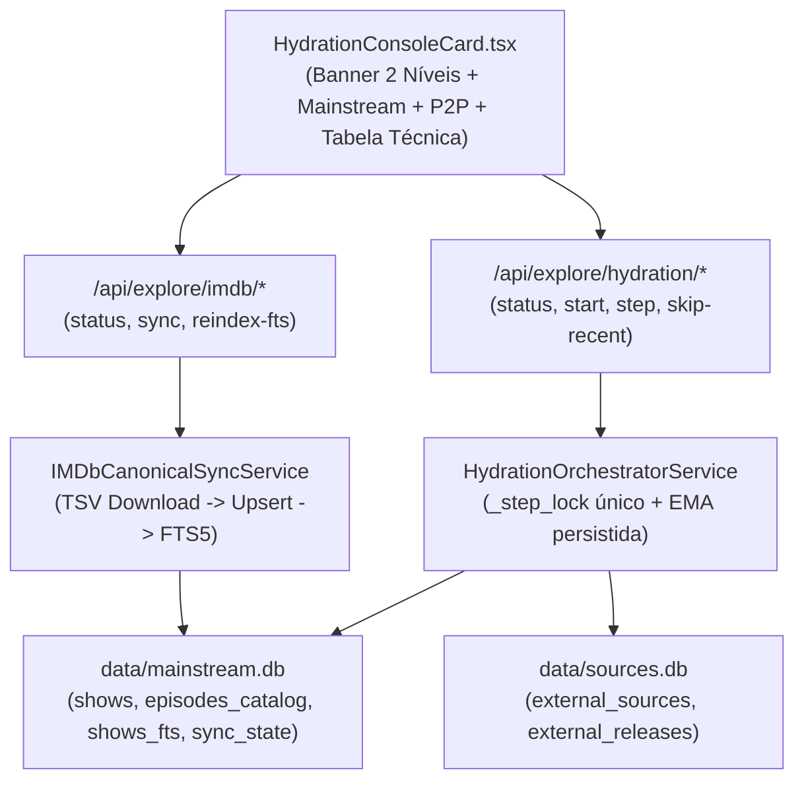

# ADR-018 Blueprint Técnico

## 1. Arquitetura Lógica (Camadas & Fluxo de Controle)

---

## 2. Contratos de Dados (Backend Schemas)

### 2.1 `HydrationCoverageSummary` (extensão retrocompatível)
- Existentes preservados: `total_shows`, `with_poster`, `with_synopsis`, `with_synopsis_ptbr`, `missing_posters`, `missing_synopsis`, `pending_details`, `posters_pct`, `synopsis_pct`, `synopsis_ptbr_pct`.
- Novos campos (Bloco 1):
  - `total_episodes: int = 0`
  - `with_tmdb_id: int = 0`
  - `tmdb_pct: float = 0.0`
  - `series_total: int = 0`
  - `series_with_tvmaze_id: int = 0`
  - `tvmaze_pct: float = 0.0`
  - `tmdb_configured: bool = False`
  - `imdb_last_sync_at: Optional[str] = None`

### 2.2 `PillarSourceCursor` & `HydrationPipelineStatus`
- `PillarSourceCursor`:
  - `sweep_pct: float = 0.0`
  - `sweep_total: int = 0`
  - `eta_seconds: Optional[int] = None`
  - `rate_per_minute: float = 0.0`
  - `consecutive_zero_recent_pages: int = 0`
- `HydrationPipelineStatus`:
  - `metadata_batches_executed: int = 0`
  - `sidecar_eta_seconds: Optional[int] = None`
  - `ema_rates: dict[str, float] = Field(default_factory=dict)`
  - `target_provider: Optional[str] = None`
  - `metadata_mode: Literal["pending", "missing_synopsis_ptbr"] = "pending"`
  - `metadata_completed_notified: bool = False`

### 2.3 `IMDbSyncJobStatus` (Bloco 2)
- `state: Literal["IDLE", "RUNNING", "COMPLETED", "ERROR"]`
- `stage: Literal["idle", "downloading", "importing_works", "importing_episodes", "rebuilding_fts", "completed", "error"]`
- `progress_pct: float = 0.0`
- `include_episodes: bool = False`
- `works_processed: int = 0`
- `episodes_processed: int = 0`
- `last_sync_at: Optional[str] = None`
- `last_error: Optional[str] = None`

---

## 3. Cálculo de EMA Persistida e `sidecar_eta_seconds`

1. Ao fim de cada `run_single_step`, para cada fonte Sidecar ativa com `scanned > 0`:
   - `inst_rate = (scanned / step_dur) * 60.0` (itens ou títulos/min).
   - `ema_prev = state.ema_rates.get(sk, inst_rate)`
   - `state.ema_rates[sk] = round(0.35 * inst_rate + 0.65 * ema_prev, 2)`
2. Para cada fonte em modo `BOOTSTRAP` com `recent_exhausted == True`:
   - `remaining = max(0, total_canonical - sc.catalog_sweep_offset)`
   - `sc.sweep_total = total_canonical`
   - `sc.sweep_pct = round(min(100.0, (sc.catalog_sweep_offset / total_canonical) * 100.0), 1)`
   - `sc.eta_seconds = int((remaining / ema_rate) * 60)` se `ema_rate > 0`.
3. `state.sidecar_eta_seconds = max([sc.eta_seconds for sc in sidecar_cursors if sc.eta_seconds], default=None)`.
4. `state.eta_seconds = max([v for v in (yts_eta, meta_eta, sidecar_eta) if v is not None], default=None)`.

---

## 4. Layout UI/UX (`HydrationConsoleCard.tsx`)

1. **Banner de Prontidão em 2 Níveis:**
   - Topo exibe estado claro: quando `pending_details === 0` e `yify.bootstrap_completed`, destaca `"Catálogo Principal, Capas e YTS em dia"` ao lado do status `"Varredura P2P em andamento"`.
2. **Bloco 1 — Base Canônica & Metadados (Mainstream) [3 cards]:**
   - **IMDb (Base Canônica):** obras (`279.362`), episódios (`4,52M`), indicador de frescor (`Atualizada há X dias`), barra de etapa durante sync TSV, botões `Atualizar Datasets` (com checkbox `Incluir episódios`) e `Reindexar FTS5`.
   - **TMDB:** barra de cobertura real (`tmdb_pct%` — `with_tmdb_id / total_shows`), badge `"Chave ausente"` se `!tmdb_configured`, botão `Focar / Rodar` (`target_provider="tmdb"`) com escolha `Pendentes` ou `Sem sinopse PT-BR`.
   - **TVMaze:** barra de cobertura real de séries (`tvmaze_pct%` — `series_with_tvmaze_id / series_total`), botão `Focar / Rodar` (`target_provider="tvmaze"`).
3. **Bloco 2 — Fontes P2P [6 cards]:**
   - Mantém os 6 cards com micro-barra de `%` do *sweep*, taxa EMA e ação rápida `"Pular recentes"` quando aplicável.
4. **Gaveta Técnica Expansível (recolhida por padrão):**
   - Tabela consolidada com todas as fontes (Mainstream + P2P): modo, offset/progresso, taxa EMA (`/min`), ETA individual, erros/cooldown e ações individuais.
