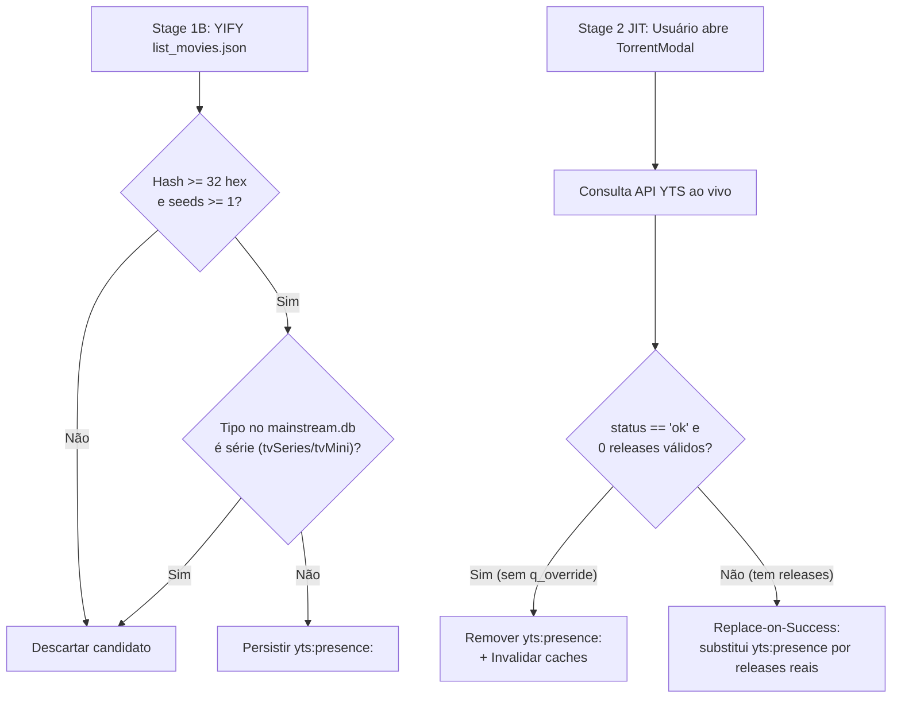

# ADR-019 Blueprint Técnico

## 1. Fluxo de Validação e Auto-Cura

---

## 2. Alterações por Módulo

### 2.1 `src/backend/providers/sources/yify_adapter.py`
- **`YIFYAdapterConfig`:**
  - `mirror_strategy: Literal["official_first", "accel_first"] = Field(default="official_first", ...)`
- **`_candidate_endpoints(cfg)`:**
  - Se `mirror_strategy == "official_first"`: ordena `[yts.mx, yts.lt, yts.gg, cfg.base_url]` (deduplicado).
  - Se `accel_first`: mantém `[cfg.base_url, *cfg.mirrors]`.
- **`_is_valid_btih(info_hash)`:**
  - Valida `len(h) in (32, 40)` hexadecimal antes de emitir candidato.
- **`persist_sync_candidates(..., mainstream_session: Optional[Session] = None)`:**
  - Quando `mainstream_session` for passado, consulta em lote `SELECT imdb_id FROM shows WHERE imdb_id IN (...) AND title_type IN ('tvSeries', 'tvMiniSeries')` e ignora candidatos dessas séries.

### 2.2 `src/backend/services/sources_registry.py`
- **`get_releases_for_imdb`:**
  - Se `outcome.status == "ok"` e `not outcome.releases` e `not q_override` e `inst.source_key == "yify"`:
    - Executa `delete(ExternalRelease).where(source_key == "yify", imdb_id == norm_imdb, external_id.like("yts:presence:%"))`, commita e invalida `discovery_cache` / `catalog_cache`.
- **`prune_obsolete_releases`:**
  - Se `mainstream_session` for fornecido e `(source_key is None or source_key in ("all", "yify"))`:
    - Identifica marcadores `yts:presence:*` cuja obra em `mainstream.db` seja `tvSeries` ou `tvMiniSeries` e os remove na mesma rotina de poda.

### 2.3 `src/backend/services/hydration_orchestrator.py`
- Passar `mainstream_session` opcional para `YIFYSourceAdapter.persist_sync_candidates` na Fase 3 do `run_single_step`.
