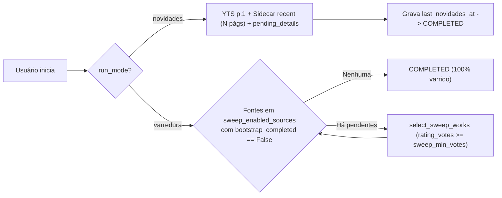

# ADR-020 Blueprint Técnico

## 1. Máquina de Estados Finita

## 2. Contratos de Dados & API

### 2.1 `HydrationPipelineStatus` (novos campos retrocompatíveis)
- `run_mode: Literal["novidades", "varredura"] = "novidades"`
- `sweep_min_votes: int = 1000` (`0 | 100 | 1000 | 5000`)
- `sweep_enabled_sources: list[str] = ["tgx", "nyaasi"]`
- `recent_pages_per_source: int = 2` (`1..10`)
- `last_novidades_at: Optional[str] = None`
- `last_novidades_count: int = 0`

### 2.2 `CanonicalCoverageSnapshot`
- `vote_tier_counts: dict[str, int]` (`"0"`, `"100"`, `"1000"`, `"5000"`)
- `nyaasi_sweep_totals: dict[str, int]` (contagem `Animation` por faixa de votos)

### 2.3 Endpoints em `src/backend/api/explore.py`
- `POST /api/explore/hydration/start`: aceita `run_mode: Literal["novidades", "varredura"] = "novidades"` (mantém compatibilidade com `scope`, `target_provider`, `metadata_mode`).
- `POST /api/explore/hydration/config`: atualiza `sweep_min_votes`, `sweep_enabled_sources` e `recent_pages_per_source`, reabrindo `bootstrap_completed` se o novo `sweep_total > catalog_sweep_offset`.
