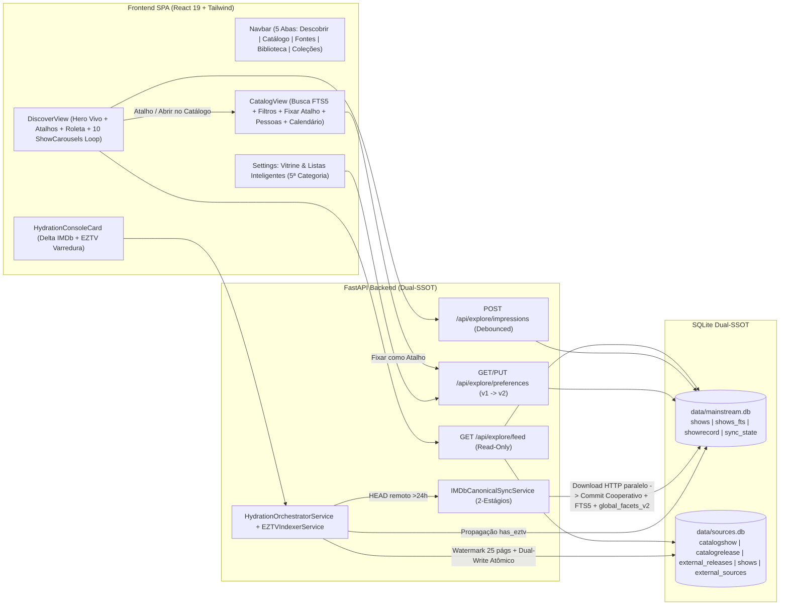

# ADR-021 Blueprint Técnico (Hardened)

## 1. Arquitetura Global (C4 — Containers & Fluxo de Dados)



---

## 2. Contratos de Backend & Esquemas Tipados

### 2.1 IMDb Sync em 2 Estágios (`src/backend/services/imdb_sync_service.py` + `scripts/imdb-metadata-catalog.py`)

```python
class IMDbSyncJobStatus(BaseModel):
    state: Literal["IDLE", "RUNNING", "COMPLETED", "ERROR"] = "IDLE"
    stage: Literal[
        "idle", "checking_remote", "downloading",
        "importing_works", "importing_episodes", "rebuilding_fts",
        "refreshing_facets", "completed", "error",
    ] = "idle"
    progress_pct: float = 0.0
    include_episodes: bool = False
    works_processed: int = 0
    episodes_processed: int = 0
    delta_inserted: int = 0
    delta_updated: int = 0
    local_last_modified: Optional[str] = None
    remote_last_modified: Optional[str] = None
    cache_status: Literal["unknown", "up_to_date", "downloaded", "remote_check_failed"] = "unknown"
    last_sync_at: Optional[str] = None
    last_error: Optional[str] = None
    message: Optional[str] = None
```

- **Protocolo de Execução:**
  1. `check_remote_updates()` faz `HTTP HEAD` em `ratings`, `basics`, `akas` comparando `ETag`/`Last-Modified` contra `.imdb_cache/*.meta.json`.
  2. Em `HydrationOrchestratorService.run_single_step` (`run_mode == "novidades"`): se `check_remote_updates()` indicar revisão mais nova **e** `last_sync_at` > 24h (ou ausente), dispara `imdb_sync_service.start_sync(include_episodes=False)` em background.
  3. **Estágio 1 (Download Paralelo):** Limpa `.tmp` órfãos em `.imdb_cache/` e baixa `ratings`, `basics`, `akas` para `.tmp` → replace atômico **sem abrir conexão SQLite**.
  4. **Estágio 2 (Commit Cooperativo):** Pausa `hydration_orchestrator` se `RUNNING`, aplica upsert em `shows` (retornando `delta_inserted`, `delta_updated`), reconstrói `shows_fts`, chama `DiscoveryEngineRepository.refresh_global_facets_cache(session)` e retoma o orquestrador se estava ativo.
  5. **Hermeticidade:** Sob `PYTEST_CURRENT_TEST`, nunca instancia `Session(mainstream_engine)` global; persiste apenas na `session` injetada.
  6. **Zero Falso Atualizado:** Se `HEAD` falhar, `cache_status = "remote_check_failed"`, `state = "ERROR"` (ou alerta explícito), **sem** atualizar `last_sync_at`.

### 2.2 Motor EZTV Unificado (`catalog_indexer.py`, `sources_registry.py`, `hydration_orchestrator.py`)

- **Paginação por Watermark (`EZTVIndexerService.sync_pages_until_watermark`):**
  - Varre páginas `1..max_pages` (padrão `max_pages=25`, delay `0.35s`, backoff em `429/5xx`).
  - Mantém `consecutive_zero_new_pages`: para antecipadamente quando `consecutive_zero_new_pages >= 2` ou página vazia/repetida.
- **Dual-Write Atômico em `sources_session`:**
  - Grava em `CatalogRelease` e `CatalogShow` (compatibilidade legada).
  - Faz UPSERT idempotente em `ExternalRelease` (`source_key="eztv"`, `external_id=str(eztv_id)`, `imdb_id=norm_imdb`, `season`, `episode`, `magnet_url`, `seeds`, `peers`, `quality`).
  - Cria `EZTVShow` em `sources.db` quando `norm_imdb` ainda não existir em `shows` (garantindo que o catálogo EZTV cresça além de `860` títulos).
  - Ao final do lote, propaga `has_eztv = 1` para `mainstream.db` nos `affected_imdb_ids` e atualiza `state.sources["eztv"]` (`titles_indexed`, `releases_indexed`, `last_run_at`).
- **Contadores Reais (`SourcesRegistryService._recompute_source_counters`):**
  - Remove `if rec.source_key == "eztv": continue`. Para `eztv`, consolida `ExternalRelease(source_key="eztv")` com fallback para `COUNT(CatalogRelease)` / `COUNT(DISTINCT CatalogShow.imdb_id)`.
- **EZTV na Varredura (`run_mode == "varredura"`):**
  - `eztv` passa a ser fonte elegível em `sweep_enabled_sources`; quando habilitada na varredura, varre séries salvas em `showrecord` (com `imdb_id`) via `EZTVProvider.get_torrents_by_imdb` para retro-preencher episódios faltantes.

### 2.3 Preferências Retrocompatíveis `v1 → v2` (`src/backend/repositories/preferences.py`)

```python
SmartListSort = Literal["balanced", "rating", "popularity", "newest", "p2p_recent"]

class SmartListConfig(BaseModel):
    id: str
    title: str
    category: str                  # ex.: "trending_now", "p2p_fresh", "because_you_watched", ...
    enabled: bool = True
    order: int = 0
    limit: int = Field(default=100, ge=20, le=100)
    sort_by: SmartListSort = "balanced"
    only_with_media: bool = False
    variance_override: Optional[int] = Field(default=None, ge=0, le=100)

class CustomShortcutConfig(BaseModel):
    id: str
    label: str
    filters: dict[str, Any]        # FilterSnapshot serializado
    pinned: bool = True

class UserExplorePreferences(BaseModel):
    schema_version: Literal[1, 2] = 2
    badge_provider_action: ProviderBadgeAction = "filter_provider"
    badge_media_action: MediaBadgeAction = "open_sources_modal"
    auto_apply_filters: bool = False
    show_all_genres: bool = False
    filter_panel_expanded: bool = False
    # Novos campos v2 (defaults seguros na migração automática de v1)
    discovery_variance_pct: int = Field(default=45, ge=0, le=100)
    hero_auto_rotate: bool = True
    hero_interval_sec: int = Field(default=12, ge=5, le=60)
    impression_ttl_hours: int = Field(default=48, ge=12, le=168)
    smart_lists: list[SmartListConfig] = Field(default_factory=default_smart_lists_v2)
    hidden_builtin_shortcuts: list[str] = Field(default_factory=list)
    custom_shortcuts: list[CustomShortcutConfig] = Field(default_factory=list)
```

### 2.4 Motor `DiscoveryFeedService` (`src/backend/services/discovery_feed.py`)

- **Endpoints (`src/backend/api/explore.py`):**
  - `GET /api/explore/feed?session_seed=<str>&roulette_scope=<all|movie|tv_show|with_media>&roulette_spin=<int>`: **100% read-only**.
  - `POST /api/explore/impressions`: corpo `{ "imdb_ids": ["tt..."], "surface": "hero" | "roulette" }`, atualiza ring-buffer `discovery_impressions_v1` em `sync_state` (máx. 200 registros, expurgando expirados por `impression_ttl_hours`).
- **Perfil Normalizado da Biblioteca:**
  - Lê `ShowRecord` (`showrecord`), normaliza cada gênero via `canonical_taxonomy.py` (unificando PT-BR e EN-US), aplica peso por status (`watching=3.0`, `completed=2.0`, `plan_to_watch=1.0`, `abandoned=-1.0`) e escolhe 1–3 títulos âncora ativos para *"Porque você assiste/curtiu [Título]"*.
- **Fórmula de Score + Variância (`0%–100%`):**
  - Pool pré-filtrado por qualidade mínima (poster válido, piso de nota/votos do bucket).
  - $\text{BaseScore} = 0.35 \cdot S_{\text{recency}} + 0.30 \cdot S_{\text{quality}} + 0.20 \cdot S_{\text{affinity}} + 0.15 \cdot S_{\text{media}} - P_{\text{impression}}$
  - Com `v = variance_pct / 100.0`: $\text{FinalScore} = (1 - 0.65v) \cdot \text{BaseScore} + (0.65v) \cdot U(\text{session\_seed}, \text{list\_id}, \text{imdb\_id})$, onde $U \in [0, 1]$ é determinístico por hash SHA-256.
  - Em `v = 0`, ordenação 100% determinística; em `v = 1.0`, alta rotação dentro do pool de qualidade.
- **10 Listas Inteligentes Padrão (7 Gerais + 3 Personalizadas) & Alocação por Escassez:**
  1. **Alocação interna (ordem de escassez crescente para `seen_global`):**
     - `hero_pool` (12 itens) → `roulette` (3 itens: *Novidade c/ Mídia*, *Sua Afinidade*, *Joia Oculta*) → `because_you_watched` → `on_your_radar` → `hidden_gems_for_you` → `running_series` (*Séries Imperdíveis em Exibição*) → `p2p_fresh` (*Recém-Chegados com Mídia P2P*) → `crime_mystery` → `scifi_fantasy_thriller` → `anime_animation_docs` → `acclaimed_movies` → `trending_now` (*Em Alta Agora 2024–2026*).
  2. **Saída visual:** reordenada exatamente conforme `smart_lists[i].order`, garantindo **até 1.000 títulos 100% únicos** entre as 10 listas (mais catálogo extensível de categorias extras opcionais para o usuário trocar nas Configurações).
  3. Cada lista retorna também `catalog_filter: FilterSnapshot` para alimentar o botão **"Abrir no Catálogo"**.

---

## 3. Arquitetura de Frontend

1. **`Navbar.tsx` (5 Abas de 1 Palavra):**
   - `AppTabId = "discover" | "catalog" | "sources" | "library" | "collections" | "config"`
   - Rótulos desktop/mobile: **Descobrir · Catálogo · Fontes · Biblioteca · Coleções** + busca global (redireciona para **Catálogo**).
2. **`App.tsx` (Estado Compartilhado):**
   - Eleva `catalogFilters: FilterSnapshot` para persistir filtros ao navegar entre abas.
   - Expõe `openCatalogWithFilters(next: Partial<FilterSnapshot>, toastMsg?: string)` usado pelos Atalhos da Vitrine, badges de provedor/mídia e botão *"Abrir no Catálogo"* das 10 Listas.
3. **`DiscoverView.tsx` (Vitrine Pura):**
   - `HeroBanner` (auto-rotação 12s pausável no hover, setas, pills de progresso, selo explicativo, dispara `POST /impressions` após 2s de visualização).
   - Barra de **Atalhos** (Essenciais + Dinâmicos da Biblioteca + Customizados do usuário; removido *Direção: Denis Villeneuve*).
   - **Roleta de Descoberta** com chips de escopo (*Tudo / Filmes / Séries / Com Mídia*), 3 cards com tag de arquétipo e botão *"Sortear 3 Novamente"* (incrementa `roulette_spin` no backend).
   - **10 `ShowCarousel`s** com janela circular virtualizada (~24 cards no DOM), indicador `1–20 de 100 · loop`, setas infinitas e botão *"Abrir no Catálogo"*.
4. **`CatalogView.tsx` (Motor de Busca & Filtros):**
   - Extraído de `ExplorerView.tsx`, abre imediatamente no cabeçalho de busca/filtros (0 scrolls), Pessoas, Calendário e botão **"Fixar como Atalho"** que grava o `FilterSnapshot` atual em `custom_shortcuts`.
5. **5ª Categoria de Configurações (`Vitrine & Listas Inteligentes`):**
   - Novo painel `src/frontend/src/components/settings/DiscoveryFeedPanel.tsx` registrado em `SettingsSidebar.tsx` (`id: "discover_feed"`):
     - Controles globais: slider de **Variância (`0%–100%`)**, auto-rotação do Hero (`on/off` + intervalo), TTL da memória de exposição (`12h–168h`).
     - Gestor das **10+ Listas Inteligentes**: ativar/desativar, reordenar (↑/↓), escolher limite (`20..100`), ordenação, filtro *"Só com Mídia"* e override opcional de variância por lista.
     - Gestor de **Atalhos**: ocultar/exibir padrões e renomear/excluir Atalhos customizados.
