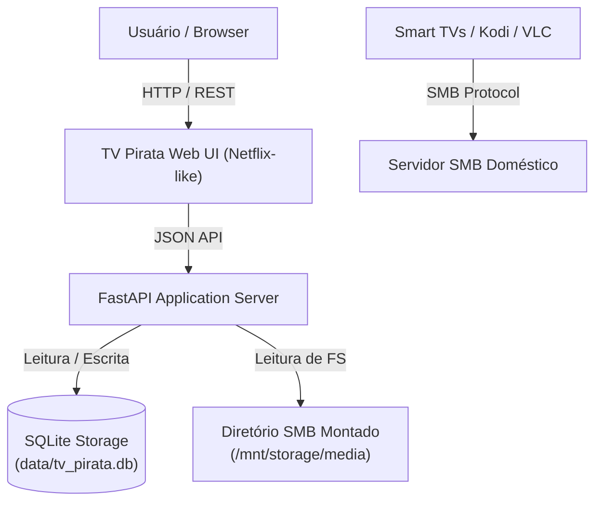

# Blueprint Arquitetural — ADR-001

## 1. Visão Arquitetural C4 (Container)

## 2. Limites de Responsabilidade e Invariantes

1. **Invariante de Desacoplamento:** Nenhuma falha de I/O na rede SMB pode derrubar ou travar o servidor FastAPI.
2. **Invariante de Preservação:** Exclusão de arquivos físicos no disco nunca deve purgar histórico de episódios assistidos.
3. **Invariante de Desempenho:** Rotas de navegação do catálogo devem responder em $P_{95} < 30\text{ms}$ utilizando cache local.
