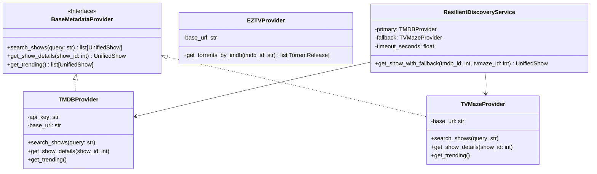

# Blueprint Arquitetural — ADR-003

## 1. Diagrama de Classes e Contratos de Domínio

## 2. Estrutura do UnifiedShow (Pydantic Schema)

- `id`: int (TMDB ID prioritário ou derivado TVMaze)
- `tmdb_id`: Optional[int]
- `tvmaze_id`: Optional[int]
- `imdb_id`: Optional[str]
- `title`: str
- `original_title`: Optional[str]
- `overview`: str
- `poster_url`: Optional[str]
- `backdrop_url`: Optional[str]
- `rating`: float
- `genres`: list[str]
- `first_air_date`: Optional[str]
- `status`: Optional[str]
- `source_provider`: str ("tmdb" | "tvmaze")
- `seasons`: list[UnifiedSeason]
