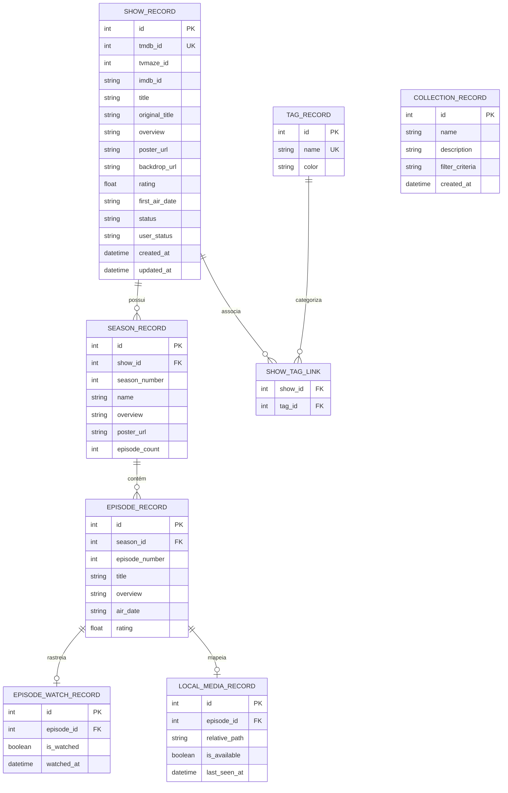

# Blueprint Arquitetural — ADR-004

## 1. Diagrama de Relacionamento de Entidades (ERD Completo SQLModel)



## 2. Mapa de Rotas REST da Aplicação FastAPI

```text
/api/
├── discovery/
│   ├── GET  /trending                   # Séries em alta na semana
│   ├── GET  /search?q={query}           # Busca com fallback automático TMDB -> TVMaze
│   └── GET  /shows/{tmdb_id}            # Detalhes completos do show
├── library/
│   ├── GET  /shows                      # Listar séries da biblioteca pessoal
│   ├── POST /shows                      # Salvar série descoberta na biblioteca
│   ├── GET  /shows/{id}                 # Obter série da biblioteca com temporadas/episódios
│   ├── PATCH /shows/{id}/status         # Atualizar status geral (watching, completed, etc)
│   └── DELETE /shows/{id}               # Remover série da biblioteca pessoal
├── watches/
│   ├── POST /episodes/{id}/toggle       # Alternar estado de assistido do episódio
│   ├── POST /seasons/{id}/watch-all     # Marcar temporada inteira como assistida
│   └── GET  /shows/{id}/progress        # Obter estatísticas percentuais de visualização
├── torrents/
│   └── GET  /shows/{imdb_id}            # Listar releases e magnets da EZTV
└── collections/
    ├── GET  /                           # Listar coleções e tags
    ├── POST /smart                      # Criar Smart Collection com filter_criteria JSON
    └── GET  /smart/{id}/items           # Executar consulta dinâmica da Smart Collection
```

