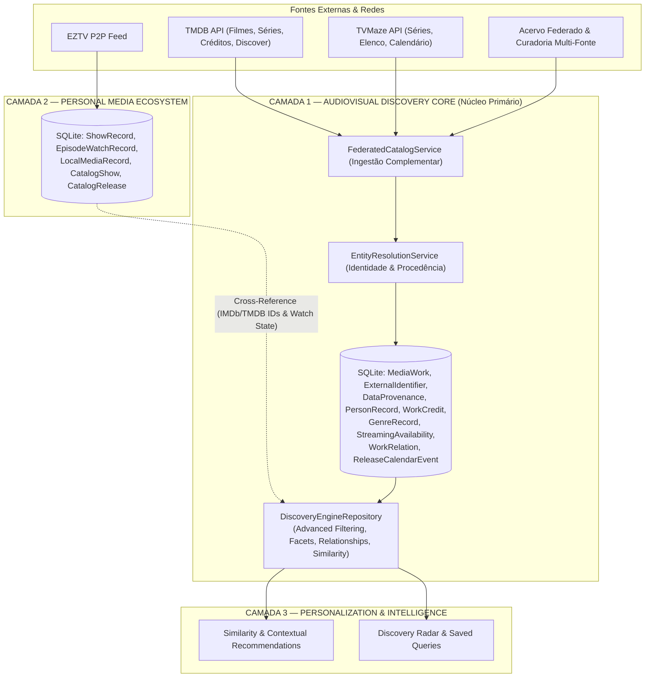

# Blueprint: ADR-008 — Fundação do Audiovisual Discovery Core (Camada 1)

## 1. Arquitetura em 3 Camadas (Discovery-First)

---

## 2. Modelo Relacional do Domínio Audiovisual (`src/backend/models/catalog_domain.py`)

### 2.1 `MediaWork` (Entidade Canônica de Obra Audiovisual)
- `id`: `Optional[int]` (PK)
- `work_type`: `str` (`movie`, `tv_show`, `mini_series`, `special`, `documentary`, `animation`) — indexado
- `title`: `str` — indexado
- `original_title`: `Optional[str]` — indexado
- `overview`: `str`
- `tagline`: `Optional[str]`
- `release_date`: `Optional[str]` (`YYYY-MM-DD`) — indexado
- `end_date`: `Optional[str]`
- `release_year`: `Optional[int]` — indexado
- `runtime_minutes`: `Optional[int]` — indexado
- `status`: `str` (`Released`, `Returning Series`, `Ended`, `In Production`, `Announced`, `Upcoming`) — indexado
- `origin_country`: `str` (código ISO, ex.: `US`, `GB`, `BR`, `KR`, `JP`, `DE`) — indexado
- `original_language`: `str` (ex.: `en`, `pt`, `ko`, `ja`, `es`, `de`) — indexado
- `poster_url`: `Optional[str]`
- `backdrop_url`: `Optional[str]`
- `canonical_rating`: `float` — indexado
- `rating_source`: `str` (`imdb`, `tmdb`, `tvmaze`, `consolidated`)
- `ratings_breakdown`: `str` (JSON preservando cada nota por fonte e número de votos sem misturar indiscriminadamente)
- `popularity_score`: `float` — indexado
- `seasons_count`: `int` (0 para filmes)
- `episodes_count`: `int` (0 para filmes)
- `network_or_studio`: `Optional[str]` (ex.: `HBO`, `A24`, `Apple Original Films`, `AMC`, `FX`)
- `collection_name`: `Optional[str]` (franquia/coleção canônica)
- `imdb_id`: `Optional[str]` — indexado para ponte rápida
- `tmdb_id`: `Optional[int]` — indexado
- `tvmaze_id`: `Optional[int]` — indexado
- `wikidata_id`: `Optional[str]` — indexado
- `created_at` / `updated_at`: `datetime`

### 2.2 `ExternalIdentifier` (Identificadores Cruzados e Nível de Confiança)
- `id`: `Optional[int]` (PK)
- `work_id`: `int` (FK `mediawork.id`, indexado)
- `provider`: `str` (`imdb`, `tmdb`, `tvmaze`, `wikidata`)
- `external_id`: `str` (indexado)
- `confidence`: `str` (`deterministic`, `high`, `probabilistic`)
- `UniqueConstraint("provider", "external_id", name="uq_external_provider_id")`

### 2.3 `DataProvenance` (Rastreabilidade e Procedência de Metadados)
- `id`: `Optional[int]` (PK)
- `work_id`: `int` (FK `mediawork.id`, indexado)
- `source_provider`: `str` (`tmdb`, `tvmaze`, `imdb`, `wikidata`, `eztv-catalog`)
- `external_id`: `str`
- `field_name`: `str` (`title`, `overview`, `rating`, `release_date`, `runtime_minutes`, `status`, `genres`)
- `field_value`: `str`
- `selection_reason`: `str` (ex.: `canonical_priority`, `completeness_score`, `corroborated_match`)
- `fetched_at`: `datetime`

### 2.4 `PersonRecord` & `WorkCredit` (Elenco, Direção, Roteiro e Equipe)
- `PersonRecord`: `id`, `name` (indexado), `imdb_id`, `tmdb_id`, `tvmaze_id`, `known_for_department` (`Directing`, `Acting`, `Writing`, `Creator`), `profile_url`, `birth_year`, `country`.
- `WorkCredit`: `id`, `work_id` (FK), `person_id` (FK), `role_type` (`director`, `actor`, `writer`, `creator`, `producer`), `character_name`, `billing_order`.

### 2.5 `GenreRecord` & `WorkGenreLink` (Taxonomia Normalizada de Gêneros)
- `GenreRecord`: `id`, `slug` (unique, indexado), `name` (ex.: `Ficção Científica`, `Suspense`, `Crime`, `Drama`, `Comédia`, `Documentário`, `Animação`, `Fantasia`, `Ação`, `Mistério`, `Terror`, `História`).
- `WorkGenreLink`: `work_id` (PK/FK), `genre_id` (PK/FK).

### 2.6 `StreamingAvailability` (Disponibilidade por Plataforma e Território)
- `id`: `Optional[int]` (PK)
- `work_id`: `int` (FK `mediawork.id`, indexado)
- `provider_name`: `str` (`Netflix`, `Prime Video`, `Max`, `Apple TV+`, `Disney+`, `MUBI`, `Globoplay`, `Paramount+`) — indexado
- `territory`: `str` (`BR`, `US`, `GLOBAL`) — indexado
- `monetization_type`: `str` (`flatrate`, `rent`, `buy`, `free`)
- `link_url`: `Optional[str]`
- `source_provider`: `str`
- `updated_at`: `datetime`

### 2.7 `WorkRelation` (Relações Explícitas entre Obras)
- `id`: `Optional[int]` (PK)
- `source_work_id`: `int` (FK `mediawork.id`, indexado)
- `target_work_id`: `int` (FK `mediawork.id`, indexado)
- `relation_type`: `str` (`sequel`, `prequel`, `spinoff`, `remake`, `reboot`, `collection`, `related`)
- `notes`: `Optional[str]`

### 2.8 `ReleaseCalendarEvent` (Agenda Audiovisual e Estreias)
- `id`: `Optional[int]` (PK)
- `work_id`: `int` (FK `mediawork.id`, indexado)
- `event_type`: `str` (`theatrical_premiere`, `streaming_premiere`, `digital_release`, `new_season`, `new_episode`, `series_return`, `announced_production`) — indexado
- `event_date`: `str` (`YYYY-MM-DD`, indexado)
- `confidence_level`: `str` (`confirmed`, `estimated`, `announced`) — indexado
- `territory`: `str` (`BR`, `US`, `GLOBAL`)
- `platform_or_network`: `Optional[str]`
- `season_number`: `Optional[int]`
- `episode_number`: `Optional[int]`
- `event_title`: `str`
- `source_provider`: `str`

---

## 3. Resolução de Identidade (`EntityResolutionService`)

Hierarquia determinística e heurística de resolução:
1. **Nível 1 (`deterministic`):** Match exato por `imdb_id`, `(work_type, tmdb_id)` ou `wikidata_id` na tabela `ExternalIdentifier`.
2. **Nível 2 (`high`):** Match por `title` ou `original_title` normalizado **E** mesmo `work_type` **E** mesmo `release_year` ($\pm 0$ para filmes, $\pm 1$ para séries), desde que não haja conflito explícito de `imdb_id` distinto (protegendo contra colisão de homônimos ou remakes em anos próximos).
3. **Nível 3 (`probabilistic`):** Caso título seja similar mas ano ou diretor divirjam (ex.: *Dune* 1984 de David Lynch vs *Dune* 2021 de Denis Villeneuve, ou *The Office* UK 2001 vs *The Office* US 2005), **nunca funde**: cria entidades canônicas distintas e registra vínculo `WorkRelation(relation_type="remake")` quando aplicável.
4. **Registro de Procedência (`DataProvenance`):** Cada atributo fornecido por cada conector é gravado com carimbo temporal e fonte, registrando divergências (ex.: notas distintas no IMDb vs TMDB vs TVMaze) sem perda de informação.

---

## 4. Contratos da API REST (`/api/explore`)

- `GET /api/explore/works`:
  - Parâmetros de consulta combináveis:
    - `q`: Busca textual (título, título original, sinopse, franquia, estúdio)
    - `work_types`: CSV (`movie,tv_show,mini_series,documentary,animation,special`)
    - `genres_any`: CSV (`OR` lógico)
    - `genres_all`: CSV (`AND` lógico)
    - `genres_not`: CSV (`NOT` lógico)
    - `year_from`, `year_to`: `int`
    - `min_rating`, `max_rating`: `float`
    - `min_runtime`, `max_runtime`: `int`
    - `status`: CSV (`Released`, `Returning Series`, `Ended`, `In Production`, `Upcoming`)
    - `streaming_providers`: CSV (`Netflix`, `Prime Video`, `Max`, `Apple TV+`, `Disney+`, `MUBI`, `Globoplay`)
    - `territory`: `str` (`BR`, `US`)
    - `country`: CSV (`US`, `GB`, `KR`, `JP`, `BR`, etc.)
    - `language`: CSV (`en`, `pt`, `ko`, `ja`, etc.)
    - `person_query`: Nome de ator, diretor, roteirista ou criador
    - `role_type`: `director`, `actor`, `writer`, `creator`
    - `min_seasons`: `int`
    - `exclude_watched`: `bool` (cruza com `ShowRecord` / `EpisodeWatchRecord` da Camada 2)
    - `only_with_p2p`: `bool` (cruza opcionalmente com `CatalogShow` da Camada 2)
    - `sort_by`: `rating`, `popularity`, `year_desc`, `year_asc`, `title`, `runtime`
    - `page`, `page_size`
  - Retorno: `items`, `total`, `page`, `page_size`, `total_pages`, e **`facets`** dinâmicas (`work_types`, `genres`, `streaming_providers`, `decades`, `statuses`, `countries`).
- `GET /api/explore/works/{work_id}`:
  - Dossiê completo da obra: metadados canônicos, `external_ids`, `provenance`, `credits` (diretores, criadores, elenco), `genres`, `availability`, `relations` (sequências, spin-offs, remakes), `similar_works` (calculado pelo Similarity Engine multicritério), `calendar_events`, e status na Camada 2 (`in_personal_library`, `p2p_max_seeds`).
- `GET /api/explore/people` & `GET /api/explore/people/{person_id}`:
  - Listagem e dossiê de pessoas (atores, diretores, roteiristas), incluindo filmografia completa agrupada por função e **colaborações recorrentes** (outras pessoas que trabalharam juntas nas mesmas obras).
- `GET /api/explore/people/collaborations`:
  - Consulta de interseção: todas as obras em que duas ou mais pessoas trabalharam juntas.
- `GET /api/explore/calendar`:
  - Agenda unificada de estreias passadas recentes, atuais e futuras, filtrável por janela temporal, `work_type`, `event_type`, `platform` e `confidence_level`.
- `GET /api/explore/rankings`:
  - Perspectivas analíticas de descoberta: Top Filmes, Top Séries, Em Exibição Agora, Estreias Futuras Mais Aguardadas, Melhores por Plataforma de Streaming.
- `POST /api/explore/federate`:
  - Aciona sincronização federada incremental (ponte com acervo local + consulta complementar a TMDB/TVMaze).

