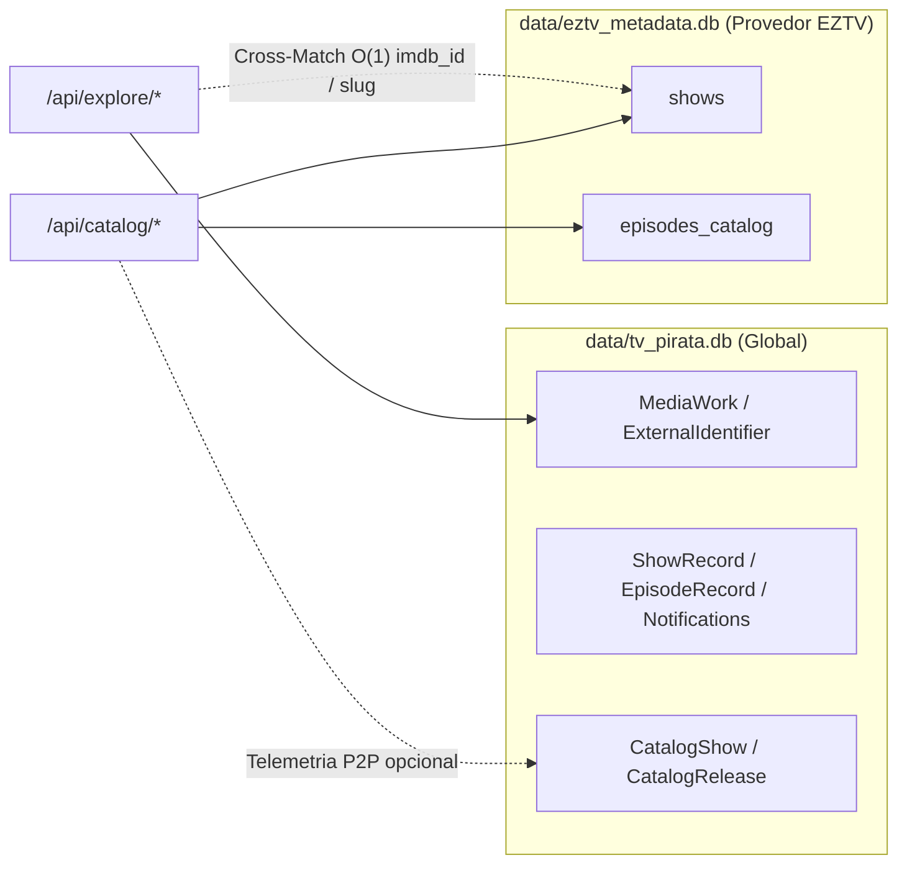

# Blueprint Técnico — ADR-009

## 1. Arquitetura de Persistência Dual

## 2. Modelos e Contratos

### 2.1 Modelos SQLModel/SQLite para `eztv_metadata.db` (`src/backend/models/eztv_db.py`)
Mapeamento fiel ao schema real gerado por `scripts/eztv-metadata-catalog.py`:
- `EZTVShow` (`__tablename__ = "shows"`): `id`, `slug`, `name`, `status`, `status_note`, `rating_score`, `rating_votes`, `rating_raw`, `tooltip`, `url`, `imdb_id`, `tvmaze_id`, `poster_url`, `synopsis`, `network`, `air_day_time`, `premiered`, `genres`, `cast_members`, `details_fetched`, `guide_synced`, `last_error`, `updated_at`.
- `EZTVEpisodeCatalog` (`__tablename__ = "episodes_catalog"`): `id`, `show_id`, `season`, `episode`, `title`, `airdate`, `runtime`, `rating`, `summary`, `source`, `updated_at`.

### 2.2 Contrato de Cruzamento em `/api/explore/*`
Cada item em `/api/explore/works` (`MediaWorkSummary`) e `/api/explore/works/{work_id}` (`MediaWorkDossier`) expõe:
- `eztv_available: bool`
- `eztv_show_id: int | None`

Algoritmo de resolução:
1. Carregar índice leve de `eztv_metadata.db`: `SELECT id, imdb_id, slug, name FROM shows`.
2. Construir mapas normalizados:
   - `by_imdb`: `ttXXXXXXX` (normalizado) $\rightarrow$ `show.id`
   - `by_slug`: `slug` e `slugify(name)` $\rightarrow$ `show.id`
3. Para cada `MediaWork`, verificar `by_imdb.get(norm_imdb)` primeiro; se ausente, verificar `by_slug.get(slugify(title))` e `by_slug.get(slugify(original_title))`.

### 2.3 Contrato de `/api/catalog/*`
- `GET /api/catalog/shows`: lista paginada a partir de `eztv_metadata.db` (`shows`), com filtros `search`, `genre`, `min_seeds`, `sort_by` (`rating`, `date`, `seeds`, `torrents`, `name`). Inclui `eztv_show_id`, `episodes_count`, `network`, `air_day_time`, `tvmaze_id`.
- `GET /api/catalog/shows/{identifier}`: aceita `imdb_id` (`tt...`) ou `eztv_show_id` numérico, retornando `show`, `episodes` (de `episodes_catalog`) e `releases` (de `CatalogRelease` em `tv_pirata.db` se houver).
- `GET /api/catalog/genres`, `/sections`, `/stats`: agregados diretamente sobre `eztv_metadata.db`.
- `POST /api/catalog/enrich-pending`: preenche `poster_url`, `synopsis`, `genres`, `rating_score`, `network`, `premiered` em `eztv_metadata.db` usando `TVMazeProvider` e `TMDBProvider`.

## 3. Critérios de Rollback
- Reverter `get_eztv_session` e restaurar consultas em `CatalogRepository` apenas para `tv_pirata.db`. Nenhuma migração destrutiva é aplicada em nenhum dos dois bancos.

