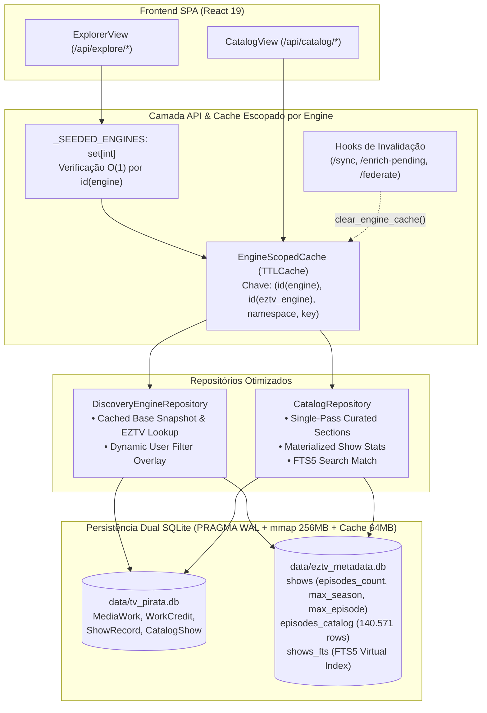

# ADR-010-BP: Blueprint Técnico — Otimização Dual-SQLite, Estatísticas Materializadas, Engine-Scoped Cache e FTS5

## 1. Visão Geral da Arquitetura de Leitura de Alta Performance



---

## 2. Especificação Detalhada por Componente

### 2.1 Tuning de Conexão SQLite via Event Listener (`DEC-001` — `src/backend/core/database.py`)

Registrar um listener `@event.listens_for(Engine, "connect")` que aplica automaticamente os `PRAGMA`s de alta performance em toda conexão SQLite criada por `engine` (`tv_pirata.db`), `eztv_engine` (`eztv_metadata.db`) ou fixtures de teste:

```python
from sqlalchemy import Engine, event

@event.listens_for(Engine, "connect")
def _configure_sqlite_pragmas(dbapi_connection: object, _connection_record: object) -> None:
    cursor = getattr(dbapi_connection, "cursor", None)
    if not callable(cursor):
        return
    cur = cursor()
    try:
        # WAL e mmap_size apenas para bancos baseados em arquivo (ou seguros em memória)
        cur.execute("PRAGMA journal_mode=WAL")
        cur.execute("PRAGMA synchronous=NORMAL")
        cur.execute("PRAGMA temp_store=MEMORY")
        cur.execute("PRAGMA cache_size=-64000")      # 64 MB de page cache por conexão
        cur.execute("PRAGMA mmap_size=268435456")    # 256 MB memory-mapped I/O
        cur.execute("PRAGMA busy_timeout=5000")      # 5s de espera cooperativa em lock de escrita
    except Exception:
        pass
    finally:
        cur.close()
```

### 2.2 Estatísticas Materializadas em `shows` e Índices B-Tree (`DEC-002` — `eztv_db.py` & `database.py`)

1. **Modelo `EZTVShow` (`src/backend/models/eztv_db.py`):**
   Adicionar três colunas inteiras indexadas/materializadas ao modelo `EZTVShow`:
   ```python
   episodes_count: int = Field(default=0)
   max_season: Optional[int] = Field(default=None)
   max_episode: Optional[int] = Field(default=None)
   ```

2. **Migração Aditiva e Backfill Idempotente (`init_eztv_db` em `src/backend/core/database.py`):**
   - Verificar via `PRAGMA table_info(shows)` a existência de `episodes_count`, `max_season` e `max_episode`. Caso ausentes, executar `ALTER TABLE shows ADD COLUMN ...`.
   - Executar backfill rápido em SQL puro para qualquer série onde `episodes_count = 0` mas existam registros em `episodes_catalog`:
     ```sql
     CREATE INDEX IF NOT EXISTS idx_episodes_show_season_ep
       ON episodes_catalog(show_id, season, episode);
     CREATE INDEX IF NOT EXISTS idx_shows_rating_year
       ON shows(imdb_rating DESC, release_year DESC);
     CREATE INDEX IF NOT EXISTS idx_shows_eztv_id
       ON shows(eztv_id);

     UPDATE shows
     SET
       episodes_count = COALESCE((
         SELECT COUNT(e.id) FROM episodes_catalog e WHERE e.show_id = shows.id
       ), 0),
       max_season = (
         SELECT MAX(e.season) FROM episodes_catalog e WHERE e.show_id = shows.id
       ),
       max_episode = (
         SELECT MAX(e.episode) FROM episodes_catalog e WHERE e.show_id = shows.id
       )
     WHERE episodes_count IS NULL OR episodes_count = 0;
     ```
   - Como o backfill só roda para linhas com `episodes_count = 0`, no primeiro boot leva `~45 ms` e nos boots subsequentes leva `< 1 ms`.

3. **Leitura O(1) de Estatísticas de Episódios em `CatalogRepository._to_dict` (`src/backend/repositories/catalog.py`):**
   - Em `list_shows`, quando `show.episodes_count > 0`, `_to_dict` usa diretamente `(show.episodes_count, show.max_season, show.max_episode)` sem tocar na tabela `episodes_catalog`!
   - Caso alguma série da página paginada final (máx. 20 itens) tenha `episodes_count == 0` e não esteja no mapa, `_build_episode_stats_map` é chamado **apenas para os IDs fatiados da página atual** (`paged_shows`) e nunca para as 860 séries antes da paginação.

### 2.3 Motor de Cache em Memória Escopado por `Engine` (`DEC-003` — `src/backend/core/cache.py`)

Para evitar poluição entre testes `pytest` (que instanciam um novo `Engine` in-memory por fixture) e eliminar recomputações dentro do ciclo de vida do processo FastAPI, criar `src/backend/core/cache.py`:

```python
from __future__ import annotations

import threading
import time
from typing import Any, Callable, TypeVar
from sqlmodel import Session

T = TypeVar("T")

class EngineScopedCache:
    """Thread-safe TTL cache partitioned by SQLAlchemy Engine identity."""

    def __init__(self, default_ttl: float = 60.0) -> None:
        self._default_ttl = default_ttl
        self._lock = threading.RLock()
        self._store: dict[tuple[Any, ...], tuple[float, Any]] = {}

    @staticmethod
    def session_scope(*sessions: Session | None) -> tuple[int, ...]:
        ids: list[int] = []
        for s in sessions:
            if s is not None:
                bind = s.get_bind()
                ids.append(id(bind))
            else:
                ids.append(0)
        return tuple(ids)

    def get_or_set(
        self,
        scope: tuple[int, ...],
        namespace: str,
        key: Any,
        factory: Callable[[], T],
        ttl: float | None = None,
    ) -> T:
        full_key = (scope, namespace, key)
        now = time.monotonic()
        with self._lock:
            entry = self._store.get(full_key)
            if entry is not None and entry[0] > now:
                return entry[1]
        value = factory()
        expires_at = now + (ttl if ttl is not None else self._default_ttl)
        with self._lock:
            self._store[full_key] = (expires_at, value)
        return value

    def invalidate_namespace(self, namespace: str | None = None) -> None:
        with self._lock:
            if namespace is None:
                self._store.clear()
                return
            keys_to_delete = [k for k in self._store if k[1] == namespace]
            for k in keys_to_delete:
                del self._store[k]
```

**Invariante de Segurança contra Mutações em Testes:**
- Como testes `pytest` podem inserir linhas diretamente em `eztv_session` ou `session` entre chamadas no mesmo teste, adicionar um *fingerprint leve de versão de tabela* (`(count_shows, max_updated_at)` obtido em `< 0.15 ms` via índice primário) na chave do cache de `CatalogRepository` e `(count_media_works, count_eztv_shows)` no `DiscoveryEngineRepository`.
- Dessa forma, se qualquer teste ou rota inserir/atualizar uma série diretamente no banco, o fingerprint muda instantaneamente e invalida o cache de forma **100% automática e determinística**, sem sequer depender apenas de chamadas manuais de invalidação!

### 2.4 Single-Pass Pipeline em `CatalogRepository.get_curated_sections` (`DEC-004`)

Em vez de invocar `list_shows(...)` 7 vezes:
1. Verificar cache escopado por `(session_scope, fingerprint, limit)`.
2. Em caso de cache miss:
   - Carregar `EZTVShow` (`SELECT * FROM shows` — 860 linhas $\approx 1,8\text{ ms}$) e `_load_p2p_stats_map(session)` **uma única vez**.
   - Para séries com `episodes_count == 0`, consultar `_build_episode_stats_map` apenas se necessário.
   - Materializar os dicionários serializados uma única vez em memória.
   - Gerar as 7 seções (`top_p2p`, `trending`, `recent`, `sci_fi`, `action`, `crime`, `drama_comedy`) aplicando filtragem de predicado e `heapq.nlargest` / `sorted` em Python sobre a lista em memória ($\approx 1,2\text{ ms}$ total para todas as 7 seções!).

### 2.5 Guarda O(1) de `_ensure_seeded` e Snapshot no `DiscoveryEngineRepository` (`DEC-005`)

1. **Guarda `_SEEDED_ENGINES` em `src/backend/services/federated_catalog.py`:**
   - Manter `_SEEDED_ENGINES: set[int] = set()`.
   - Na função `ensure_federated_catalog_seeded(session)`:
     - Calcular `engine_id = id(session.get_bind())`.
     - Se `engine_id in _SEEDED_ENGINES`, retornar `0` imediatamente em $O(1)$ sem emitir `SELECT count(mediawork.id)`.
     - Caso contrário, verificar `COUNT(MediaWork.id)`: se $> 0$, adicionar `engine_id` a `_SEEDED_ENGINES` e retornar `0`; se $== 0$, popular os 12 títulos canônicos e registrar `engine_id` em `_SEEDED_ENGINES`.
   - Adicionalmente, invocar `ensure_federated_catalog_seeded` no startup (`lifespan` de `src/backend/main.py`).

2. **Snapshot Indexado no `DiscoveryEngineRepository` (`src/backend/repositories/discovery_engine.py`):**
   - Cachear o dataset base de obras (`_BaseCatalogSnapshot`: lista de `MediaWork`, `credits_by_work`, `people_by_id`, `avail_by_work`, `p2p_by_imdb`, `p2p_by_title`, e `eztv_by_imdb`/`eztv_by_slug`) chaveado por `(session_scope, count_media_works, count_eztv_shows, count_catalog_shows)` com TTL de 60s.
   - Os dados mutáveis de usuário (`lib_by_imdb`, `watched_show_ids` quando `exclude_watched=True`) são leves e consultados/aplicados sobre o snapshot em $< 1\text{ ms}$, garantindo que adicionar/remover favoritos na Minha Biblioteca reflita imediatamente na UI!

### 2.6 Índice Virtual SQLite `FTS5` (`shows_fts`) (`DEC-006`)

1. **DDL em `init_eztv_db()` (`src/backend/core/database.py`) e `scripts/eztv-metadata-catalog.py`:**
   ```sql
   CREATE VIRTUAL TABLE IF NOT EXISTS shows_fts USING fts5(
       title,
       genres,
       network,
       streaming_providers,
       content='shows',
       content_rowid='id'
   );
   ```
   - Criar triggers `shows_ai` (AFTER INSERT), `shows_ad` (AFTER DELETE) e `shows_au` (AFTER UPDATE) para manter `shows_fts` automaticamente sincronizada com a tabela `shows` em qualquer inserção/atualização (inclusive durante testes `pytest`!).
   - Executar `INSERT INTO shows_fts(shows_fts) VALUES('rebuild')` no boot quando `shows_fts` estiver vazia e `shows` contiver registros.

2. **Consulta Acelerada em `CatalogRepository.list_shows`:**
   - Quando `q` (busca por título) for fornecido e contiver caracteres alfanuméricos, construir o token seguro FTS5 (`"termo"*`) e filtrar via `EZTVShow.id.in_(select(text("rowid")).select_from(text("shows_fts")).where(text("shows_fts MATCH :fts_query")))`, mantendo fallback automático para `EZTVShow.title.ilike(f"%{q}%")` caso a sintaxe FTS falhe ou não retorne.

### 2.7 Manutenção Contínua em `scripts/eztv-metadata-catalog.py` (`DEC-002` & `DEC-006`)

Atualizar `init_db` e o final de `sync_eztv_catalog` em `scripts/eztv-metadata-catalog.py` para:
1. Garantir as colunas `episodes_count`, `max_season`, `max_episode` em `shows`.
2. Atualizar `episodes_count`, `max_season`, `max_episode` ao final da ingestão e reconstruir o índice `shows_fts`.

---

## 3. Invariantes de Qualidade e Contratos de Teste

1. **Zero Quebra de Contratos HTTP:** Todos os payloads JSON de `/api/catalog/*` e `/api/explore/*` permanecem 100% compatíveis com a SPA React 19.
2. **Isolamento Hermético Pytest:** O cache baseado em `(session_scope, table_fingerprint)` garante que inserções diretas via `session.add(...)` nos testes existentes (`tests/integration/test_catalog_api.py`, `tests/integration/test_explore_api.py`) sejam refletidas imediatamente sem falsos positivos/negativos.
3. **SLAs de Performance Verificáveis:**
   - `CatalogRepository.list_shows(sort_by='seeds', page=1, page_size=20)` $< 15\text{ ms}$ (redução $> 98\%$ frente aos `965,61 ms`).
   - `CatalogRepository.get_curated_sections(limit=20)` $< 15\text{ ms}$ a frio e $< 2\text{ ms}$ a quente (redução $> 98\%$ frente aos `692,07 ms`).
   - `DiscoveryEngineRepository.query_works(page=1, page_size=24)` $< 25\text{ ms}$ a frio e $< 5\text{ ms}$ a quente (redução $> 85\%$ frente aos `160,87 ms`).
