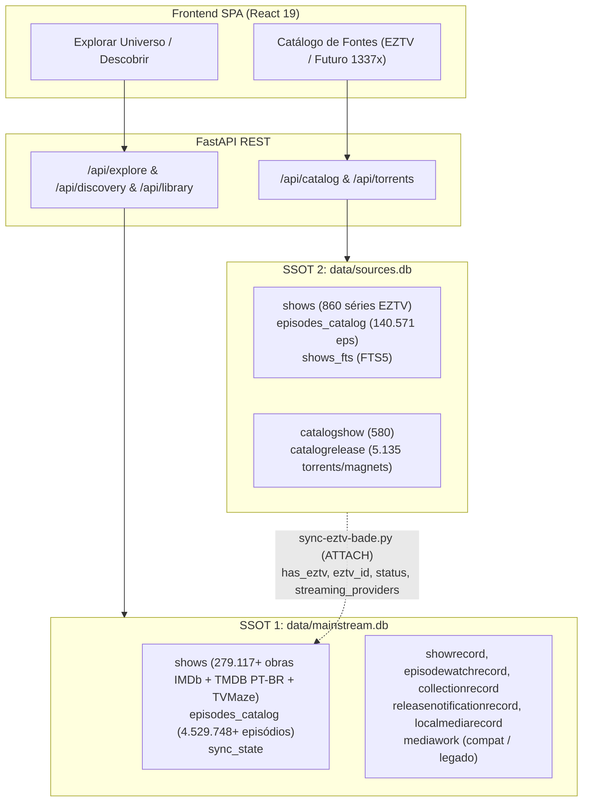

# ADR-011-BP: Blueprint Técnico — Dual-SSOT (`data/mainstream.db` & `data/sources.db`) e SQL Pushdown

## 1. Topologia de Persistência Dual-SSOT

---

## 2. Especificação das Camadas e Migrações

### 2.1 Fonte de Verdade 1: `data/mainstream.db` (`DEC-001`, `DEC-002`)
1. Origem primária: `imdb_catalog.db` (`shows`, `episodes_catalog`, `sync_state`).
2. Tabelas incorporadas de `data/tv_pirata.db` via `ATTACH DATABASE` sem colisão de nomes:
   - Biblioteca e ecossistema pessoal: `tagrecord`, `collectionrecord`, `showrecord`, `showtaglink`, `seasonrecord`, `episoderecord`, `episodewatchrecord`, `localmediarecord`, `releasenotificationrecord`.
   - Camada 1 auxiliar / retrocompatibilidade: `genrerecord`, `mediawork`, `personrecord`, `workgenrelink`, `externalidentifier`, `dataprovenance`, `workcredit`, `streamingavailability`, `workrelation`, `releasecalendarevent`.
   - Cópia de transição segura de `catalogshow`/`catalogrelease` em `mainstream.db` ou migração exclusiva para `sources.db` mantendo suporte em `get_p2p_session` (`sources_session` ou `mainstream_session`). **Pela arquitetura Dual-SSOT, `catalogshow` e `catalogrelease` pertencem canonicamente a `data/sources.db`** (`sources_session`), e o router `/api/torrents` e `CatalogRepository` passam a ler de `sources_session` (mantendo fallback se presente em testes legados).
3. Colunas aditivas em `data/mainstream.db.shows` para merge TMDB + TVMaze + Badges:
   - `tvmaze_id INTEGER`
   - `status TEXT`
   - `air_day_time TEXT`
   - `streaming_providers TEXT`
   - `has_eztv INTEGER DEFAULT 0`
   - `eztv_id INTEGER`
   - `eztv_slug TEXT`
   - `eztv_match_type TEXT`
4. Índices compostos B-Tree para filtragem sub-20ms em 279k linhas:
   - `idx_shows_votes_rating ON shows(rating_votes DESC, rating_score DESC)`
   - `idx_shows_year_votes ON shows(start_year DESC, rating_votes DESC)`
   - `idx_shows_type_votes ON shows(title_type, rating_votes DESC)`
   - `idx_shows_has_eztv ON shows(has_eztv)`
   - `idx_shows_eztv_id ON shows(eztv_id)`

### 2.2 Fonte de Verdade 2: `data/sources.db` (`DEC-001`)
1. Origem primária: `data/eztv_metadata.db` (`shows`, `episodes_catalog`, `shows_fts`).
2. Incorporação das tabelas P2P de `data/tv_pirata.db`: `catalogshow` (`580` registros) e `catalogrelease` (`5.135` registros).

### 2.3 Modelos e Aliases em `src/backend/core/database.py` e `catalog_domain.py`
- `MAINSTREAM_DATABASE_URL` (`sqlite:///data/mainstream.db`) com fallback `DATABASE_URL`.
- `SOURCES_DATABASE_URL` (`sqlite:///data/sources.db`) com fallback `EZTV_DATABASE_URL`.
- Aliases retrocompatíveis: `engine = mainstream_engine`, `eztv_engine = sources_engine`, `get_session = get_mainstream_session`, `get_eztv_session = get_sources_session`, `init_db = init_mainstream_db`, `init_eztv_db = init_sources_db`.
- Modelos `IMDbCatalogShow` (`__tablename__ = "shows"`) e `IMDbEpisodeCatalog` (`__tablename__ = "episodes_catalog"`) em `src/backend/models/catalog_domain.py` sobre `SQLModel.metadata` (`mainstream.db`), totalmente separados de `EZTVShow` / `EZTVEpisodeCatalog` em `eztv_metadata = MetaData()` (`sources.db`).

### 2.4 Motor SQL Pushdown em `DiscoveryEngineRepository` (`DEC-004`)
- Em `DiscoveryEngineRepository.query_works`: verificar em `O(1)` (cacheado por engine) se `IMDbCatalogShow` (`shows`) possui registros (`SELECT 1 FROM shows LIMIT 1`).
- Quando presente:
  - Mapear `work_types` (`movie` $\rightarrow$ `('movie', 'tvMovie')`, `tv_show` $\rightarrow$ `('tvSeries',)`, `mini_series` $\rightarrow$ `('tvMiniSeries',)`).
  - Aplicar predicados SQL `WHERE` para `year_from`/`year_to`, `min_rating`/`max_rating`, `min_runtime`/`max_runtime`, `status`, `streaming_providers`, `country`, `language`, `only_with_p2p` (`has_eztv == 1`), `genres_any` (`OR`), `genres_all` (`AND`), `genres_not` (`NOT`), `person_query`, `q` (`primary_title`, `original_title`, `title_ptbr`, `imdb_id`, `directors`, `creators`, `cast_members`) e `exclude_watched`.
  - Executar `COUNT(*)` e `SELECT ... ORDER BY ... LIMIT page_size OFFSET offset` diretamente no SQLite (apenas 24 linhas materializadas por página!).
  - Calcular facetas globais/base via queries SQL agregadas + `discovery_cache`.
  - Calcular IDs inteiros determinísticos (`imdb_num`) e suportar lookup tanto por `imdb_num` quanto por `ttXXXXXXX` em `get_work_dossier`.
- Quando `shows` estiver vazia (`0` linhas, ex.: testes unitários antigos de `MediaWork`): preservar integralmente o caminho `MediaWork`.

### 2.5 Evolução de `scripts/sync-eztv-bade.py` (`DEC-003` & `DEC-005`)
- Defaults: `data/mainstream.db` e `data/sources.db`.
- Propaga `has_eztv`, `eztv_id`, `eztv_slug`, `eztv_match_type` e preenche via `COALESCE(NULLIF(main.shows.<col>, ''), eztv_src.<col>)` os campos `tvmaze_id`, `status`, `air_day_time`, `streaming_providers`, `network` e `poster_url` quando ausentes no IMDb.
