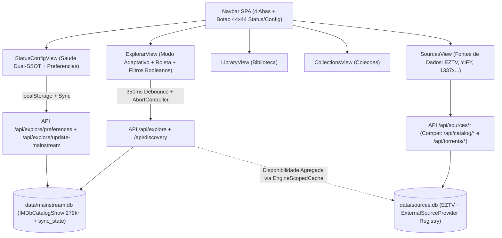

# ADR-012-BP: Blueprint Técnico da Arquitetura Elevada (`Alt_C_Hardened_MultiSource_Adaptive`)

## 1. Visão Topológica (Diagrama C4 Simplificado)



---

## 2. Especificações por Domínio (`DEC-001` a `DEC-006`)

### 2.1 Navegação & Modo Adaptativo (`DEC-001`)
- **Estrutura da `Navbar.tsx`:**
  - Abas primárias (`4`):
    1. **`Explorar`** (`id: "explore"`, rota padrão inicial; substitui `discover` + `explore`).
    2. **`Fontes de Dados`** (`id: "sources"`, substitui `catalog` / `Catálogo EZTV`; aceita alias legado `"catalog"` na inicialização de estado se necessário).
    3. **`Biblioteca`** (`id: "library"`).
    4. **`Coleções`** (`id: "collections"`).
  - Controles de utilidade no topo direito:
    - Campo de busca global com `<label htmlFor="global-search-input" className="sr-only">Buscar títulos no catálogo</label>` e botão limpar de `min-w-[44px] min-h-[44px]` (visual compacto centralizado).
    - Botão **`Status, Sincronização & Config`** (`min-w-[44px] min-h-[44px]`, ícone de engrenagem + indicador luminoso de saúde Dual-SSOT: verde `healthy`, âmbar `syncing`/`stale`, vermelho `degraded`).
- **Comportamento Adaptativo em `ExplorerView.tsx`:**
  - **Modo Ocioso** (`query === ""` e zero filtros restritivos ativos): exibe `HeroBanner` editorial + **Quick-Intent Bar** (atalhos de formato/gênero/streaming/com mídia) + **Roleta Contrastiva** (seleção rápida de 3 obras distintas) + carrosséis temáticos acima do grid geral.
  - **Modo Busca/Filtragem Ativa:** colapsa o `HeroBanner` com transição suave (respeitando `prefers-reduced-motion`) e traz o contador de resultados + barra de ordenação + grid para a dobra superior.

---

### 2.2 Camada Multi-Fonte de Dados (`DEC-002`)

#### A. Generalização Aditiva em `data/sources.db` (`src/backend/models/db.py` & `services/sources/`)
Sem quebrar `EZTVShow`, `EZTVEpisodeCatalog` (`eztv_metadata`), `CatalogShow` ou `CatalogRelease`:
1. Criar registro polimórfico de indexadores (`ExternalSourceProvider` / `SourceRegistry`) mapeando provedores canônicos (`eztv`, `yify`, `1337x`, extensível a links/HTTP/torrents).
2. Introduzir modelo genérico aditivo em `data/sources.db`:
   - `ExternalSourceRecord` (`external_sources`): `source_key` (`eztv`, `yify`, `1337x`), `display_name`, `kind` (`torrent_api`, `scrape_index`, `link_catalog`), `enabled`, `last_sync_at`, `total_titles`, `total_releases`, `status`.
   - `ExternalRelease` (`external_releases`): `id`, `source_key` (indexado), `external_id` (`str`, indexado), `imdb_id` (`str | None`, indexado), `title`, `season`, `episode`, `quality`, `size_bytes`, `seeds`, `peers`, `magnet_url`, `external_url`, `published_at`.
   - Ponte de compatibilidade: `EZTVShow` / `CatalogRelease` continuam legíveis pelo adaptador `eztv` dentro do serviço unificado de fontes, evitando perda de dados existentes (`RT-01`).
3. **Contratos de API (Backend FastAPI):**
   - `GET /api/sources/summary` -> telemetria por provedor (`source_key`, `display_name`, `status`, `total_titles`, `total_releases`, `last_sync_at`).
   - `GET /api/sources/releases?imdb_id=...&source=...` -> releases agrupados por provedor para qualquer título.
   - `GET /api/sources/catalog` -> listagem paginada e filtrável por fonte (`eztv`, `yify`, `1337x`, etc.) alimentando `SourcesView.tsx`.
   - `POST /api/sources/sync?source=...` -> sincronização unitária ou global das fontes.
   - **Retrocompatibilidade (`INV-03`):** `/api/catalog/*` e `/api/torrents/*` delegam para a nova camada mantendo seus formatos JSON esperados por testes/clientes existentes.
4. **Agregação na Camada 1 (`EngineScopedCache`):**
   - `/api/explore` e `/api/discovery` passam a retornar em cada `ShowItem`:
     - `has_media: boolean` (`true` se presente em **qualquer** catálogo em `sources.db`)
     - `media_sources: string[]` (ex.: `["eztv", "yify"]`)
     - `sources_count: number`
     - `has_eztv?: boolean` e `eztv_id?: number | null` preservados por compatibilidade retroativa.
5. **UI Multi-Fonte (`MediaBadge.tsx` & `SourcesModal`):**
   - `EztvBadge.tsx` é substituído por `MediaBadge.tsx` (label canônica `Media`, mantendo variante/tooltip exibindo quantas e quais fontes possuem o título, ex.: `"Media • EZTV, YIFY"`).
   - `TorrentModal.tsx` evolui para exibir abas ou seções por provedor (`Todas`, `EZTV`, `YIFY`, `1337x`) suportando tanto `magnet:` quanto `external_url` seguro.

---

### 2.3 Central `Status, Sincronização & Config` & Preferências Híbridas (`DEC-003`)

#### A. Schema de Preferências (`schema_version: 1`)
```ts
export type ProviderBadgeAction = 'filter_provider' | 'open_details' | 'open_provider_info';
export type MediaBadgeAction = 'open_sources_modal' | 'filter_has_media' | 'open_details';

export interface UserExplorePreferences {
  schema_version: 1;
  badge_provider_action: ProviderBadgeAction; // default: 'filter_provider'
  badge_media_action: MediaBadgeAction;       // default: 'open_sources_modal'
  auto_apply_filters: boolean;                // default: false (modo híbrido com botão Aplicar)
  show_all_genres: boolean;                   // default: false (top-10)
  filter_panel_expanded: boolean;             // default: false
}
```

#### B. Fluxo de Persistência Híbrida (`RT-04`)
1. **Leitura Síncrona na Inicialização:** `preferencesStorage.ts` lê `tv_pirata_explore_prefs_v1` de `localStorage` com `try/catch` + validação de chaves permitidas, garantindo render imediato sem flicker.
2. **Sincronização Assíncrona:** Dispara `GET /api/explore/preferences` em background; alterações do usuário atualizam imediatamente `localStorage` + contexto React e enviam `PUT /api/explore/preferences` para gravação na tabela `sync_state` (chave `user_explore_preferences_v1`) de `data/mainstream.db`.
3. **Escopo de `StatusConfigView.tsx`:**
   - Painel de saúde em tempo real (`mainstream.db`: total de obras/episódios + botão `Atualizar Base Canônica`; `sources.db`: lista por provedor + botões `Sincronizar Fonte` / `Sincronizar Todas`).
   - Seção **Comportamento Interativo do Catálogo**: seletores explícitos para clique em Badge de Streaming, clique em Badge `Media`, e toggle `Aplicar filtros avançados automaticamente`.

---

### 2.4 Contrato Interativo do `ShowCard.tsx` (`DEC-004`)

1. **Topologia Espacial do Pôster (`aspect-[2/3]`):**
   - **Canto Superior Direito (eixo vertical):**
     1. Badge da Nota IMDb (`★ 8.7`) no topo;
     2. **`MediaBadge`** posicionado imediatamente **abaixo** da nota IMDb (quando `show.has_media || show.has_eztv`).
   - **Canto Inferior Esquerdo (eixo vertical):**
     1. Pilha de `ProviderBadge`s posicionada **acima** da `StatusBadge`;
        - Em cartões **`>= 190px`** (`sm` / `md` desktop/tablet): exibe **todos** os provedores normalizados do título empilhados verticalmente (ex.: `Netflix`, `Prime Video`, `Max`, um acima do outro);
        - Em cartões **`< 190px`** (grid 2 colunas em `375px` mobile): **Salvaguarda `1 + N`** — renderiza o provedor principal + badge `+N` clicável para expandir ou inspecionar os demais sem cobrir o pôster (`AUD-CRIT-01`).
     2. `StatusBadge` ancorada na base da coluna inferior esquerda.
   - **Canto Inferior Direito (Ações Rápidas):**
     - Substitui botões hover `p-1.5` por um **botão expansível tátil `44×44px`** sempre acessível em touch e teclado (`aria-expanded`), revelando ações agregadas (`+ Biblioteca`, `Fontes Media`, `Adicionar à Coleção`).
2. **Previsibilidade & Segregação de Cliques (`RT-02`):**
   - Clique na área livre do pôster/título abre `ShowDetailModal`.
   - Cada badge configurável (`ProviderBadge`, `MediaBadge`) usa `<button type="button">` dedicado com `e.stopPropagation()`, `cursor-pointer`, `:focus-visible` distinto e `aria-label` + `title` refletindo a ação configurada (ex.: `"Netflix — clique para filtrar por Netflix"` ou `"Media (EZTV, YIFY) — clique para abrir fontes disponíveis"`).

---

### 2.5 Motor Híbrido de Filtragem (`DEC-005`)
- **Accordion Top-10:** `showAllGenres` inicia em `false` (exibindo os 10 gêneros mais frequentes de `global_facets_v2`) com botão `"Ver todos os gêneros (31)"`, persistido em preferências.
- **Debounce + `AbortController`:** Entradas textuais (título, pessoa) aplicam `350ms` de debounce; toda consulta em `api.ts` recebe `AbortSignal` para abortar automaticamente a chamada anterior pendente (`AUD-CRIT-02`).
- **Modo Híbrido no Painel Booleano:** Alterações em combinação booleana (`OR`/`AND`/`NOT`) exibem contador de alterações pendentes e acionam via botão `"Aplicar Filtros"` (ou disparam imediatamente se `auto_apply_filters === true`).
- **Barra de Progresso Não-Destrutiva:** Durante `isRefetching`, mantém o grid montado (`opacity-90` sutil + `aria-busy="true"`) com barra linear animada no topo da seção.

---

### 2.6 Acessibilidade WCAG 2.2 AA/AAA & Nielsen Gate (`DEC-006`)
- **`index.css`:** Inserir bloco `@media (prefers-reduced-motion: reduce)` zerando durações/animações decorativas e transições de colapso.
- **Contraste & Foco:** Garantir contraste `>= 4.5:1` em todos os rótulos sobre `#090a0f` e `#131722` (usar `#cbd5e1` / `slate-300` para subtítulos em vez de cinzas apagados) e anel `:focus-visible` visível (`outline: 2px solid #38bdf8; outline-offset: 2px`).
- **Nielsen Heuristic Evaluation (3 Cenários Obrigatórios):**
  1. Descoberta + filtro rápido em mobile `375px` (`< 30s`, 0 toques acidentais).
  2. Combinação booleana (`OR`/`AND`/`NOT`) + aplicação/reset sem flicker.
  3. Compreensão e previsibilidade de cliques em `ProviderBadge` e `MediaBadge`.
