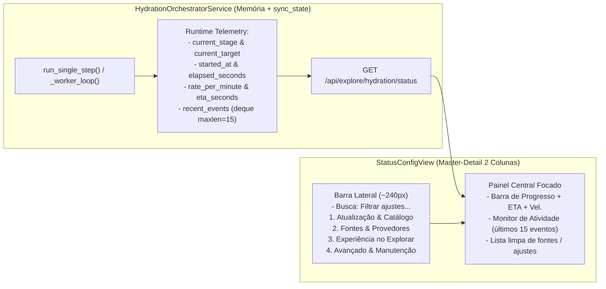

# ADR-016-BP: Blueprint Técnico

## 1. Visão Arquitetural (Backend Telemetry + Frontend IDE Settings)



---

## 2. Especificações Técnicas por Decisão (`DEC-001`..`DEC-005`)

### 2.1. `DEC-001` — Arquitetura Master-Detail (`StatusConfigView.tsx`)
Organizar `StatusConfigView.tsx` em componentes coesos sob `src/frontend/src/components/settings/`:
- `SettingsSidebar.tsx`: campo de filtro instantâneo + 4 botões de categoria (`role="tab"`, `aria-selected`, indicador pulsante verde/ciano na aba `Atualização & Catálogo` quando `hydrationStatus.state === "RUNNING"`).
- `CatalogUpdatePanel.tsx` (Categoria 1 — **Atualização & Catálogo**): controle unificado de atualização (Iniciar/Pausar, Escopo legível, barras de progresso de Capas, Sinopses e Fontes, Velocidade, Tempo Decorrido, ETA e Monitor de Atividade colapsável).
- `SourcesProvidersPanel.tsx` (Categoria 2 — **Fontes & Provedores**): tabela/cards limpos com switch habilitar/desabilitar, badge de saúde, botão **Testar** e painel lateral/drawer limpo para editar URL/credenciais ou adicionar nova fonte (removendo formulários gigantes expandidos inline).
- `ExplorePrefsPanel.tsx` (Categoria 3 — **Experiência no Explorar**): seleção clara da ação ao clicar nos selos de streaming e mídia, comportamento de aplicação automática de filtros e exibição padrão do painel de gêneros.
- `AdvancedMaintenancePanel.tsx` (Categoria 4 — **Avançado & Manutenção**): agendador periódico, disparo manual único de manutenção, limpeza/reset de varredura com confirmação e métricas técnicas de banco recolhidas em seção técnica secundária.

### 2.2. `DEC-002` — Tabela Canônica de Tradução para Linguagem Humana

| Termo Técnico Atual | Novo Rótulo Humano na UI |
| :--- | :--- |
| `Motor Unificado dos 3 Pilares (Checkpoint --resume)` | **Atualização do Catálogo** *(Retomável automaticamente)* |
| `BOOTSTRAP` / `DELTA` | **Varredura Inicial** / **Apenas Novidades** |
| `Pilar 1B: Fontes P2P` | **Disponibilidade nas Fontes** |
| `Pilar 3: Cascata Capas/Sinopses` | **Capas e Sinopses** |
| `Sweep @6` / `Recent p.8` | **Verificando catálogo (item 6)** / **Lendo página 8** |
| `TTL do Cache Lazy (Horas)` | **Tempo de cache das buscas (horas)** |
| `source_key` / `adapter_key` | **Identificador da fonte** / **Tipo de conector** |
| `Saúde Dual-SSOT` | **Saúde do Sistema e Fontes** *(detalhes técnicos apenas em Avançado)* |

### 2.3. `DEC-003` — Contrato de Telemetria Viva (`HydrationPipelineStatus`)
Novos campos opcionais/retrocompatíveis no modelo `HydrationPipelineStatus`:
```python
class HydrationActivityEvent(BaseModel):
    timestamp: str
    stage: str           # ex: "yify", "tgx", "metadata"
    target: str          # ex: "Página 31/1572" ou "Breaking Bad (tt0903747)"
    outcome: Literal["ok", "partial", "skipped", "error"] = "ok"
    message: str         # frase humana curta

# Em HydrationPipelineStatus:
current_stage: Optional[str] = None
current_target: Optional[str] = None
started_at: Optional[str] = None
elapsed_seconds: float = 0.0
items_processed_in_run: int = 0
rate_per_minute: float = 0.0
eta_seconds: Optional[int] = None
recent_events: list[HydrationActivityEvent] = Field(default_factory=list)
```
- **Cálculo de Velocidade e ETA:**
  - `elapsed_seconds = max(0.0, now - run_started_at)` enquanto `RUNNING` (ou acumulado até pausa).
  - `rate_per_minute` calculado com base nos itens/obras processadas na sessão ativa (`items_processed_in_run / max(elapsed_seconds / 60.0, 0.05)` ou média móvel dos últimos passos).
  - `eta_seconds`: quando `scope == "metadata"` ou `"all"` com `missing_posters > 0`, estima `(remaining_items / rate_per_minute) * 60`; quando em varredura YTS (`total_pages - next_page`), estima sobre páginas/itens restantes. Se `rate_per_minute <= 0`, retorna `None` (exibido como `"Calculando..."` na UI).

### 2.4. `DEC-004` — Ring Buffer `recent_events` & Cadência de Atualização
- `HydrationOrchestratorService` mantém `collections.deque(maxlen=15)` em memória, atualizado via helper `_record_event(stage, target, outcome, message)` durante cada sub-etapa (YTS, Sidecar, Cross-DB Self-Heal e Cascata de Metadados).
- `HydrationConsoleCard` / `CatalogUpdatePanel` ajusta o intervalo de polling para `1000ms` enquanto `status.state === "RUNNING"` e interrompe o polling imediatamente quando `PAUSED`/`IDLE`/`COMPLETED`.

### 2.5. `DEC-005` — Acessibilidade & Qualidade
- Alvos de clique com altura mínima `44px`.
- Busca rápida filtra ou destaca configurações correspondentes e muda automaticamente para a categoria correspondente ao clicar em um resultado.
- Zero quebra de contratos REST existentes (`/api/explore/hydration/*` mantém compatibilidade integral com `scripts/hydrate_ecosystem.py`).
