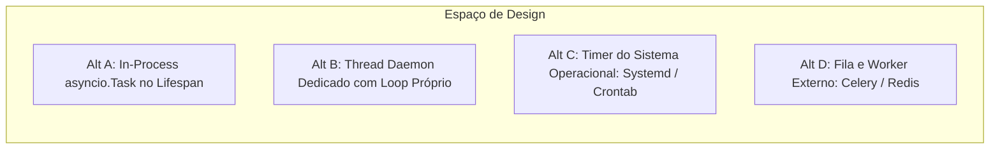

# Phase 3 — Architecture Challenge (Adversarial Review): ADR-007

## 1. Identificação de Alternativas no Espaço de Design

Para desafiar a proposta original (Alt A), formulamos três alternativas concorrentes no espectro de concorrência, acoplamento e orquestração:

---

## 2. Detalhamento das Alternativas

### Alternativa A (Original Proposta): Loop `asyncio.Task` no Lifespan do FastAPI
* **Mecanismo:** `asyncio.create_task` executado no startup do ASGI, compartilhado no event loop do Uvicorn.
* **Prós:** Zero processos extras, zero dependências, acesso direto a conexões assíncronas de HTTP (`httpx.AsyncClient`) sem troca de contexto de SO.
* **Contras:** Compartilha o mesmo event loop das requisições web; se uma operação síncrona bloquear a CPU, atrasa o tratamento de requisições HTTP.

### Alternativa B: Thread Dedicada (`threading.Thread(daemon=True)`) com Event Loop Próprio
* **Mecanismo:** Uma thread secundária do SO instanciada no startup, rodando um event loop assíncrono isolado exclusivamente para o worker.
* **Prós:** Isolamento total do loop do Uvicorn; tarefas pesadas de parse/regex não competem por ciclos do loop de requisições web.
* **Contras:** Maior complexidade na gestão de sessões de banco multithread no SQLite (exige `check_same_thread=False` e locks finos); risco maior de threads zumbis se o sinal de término não for propagado perfeitamente.

### Alternativa C: Agendador Externo via OS (Systemd Timer / Cron) chamando CLI
* **Mecanismo:** Desacoplamento absoluto do servidor web. Um cron job do Linux executa a cada hora: `.venv/bin/python scripts/sync_catalog.py --shallow --notify`.
* **Prós:** O servidor web fica 100% livre de qualquer responsabilidade de agendamento; falhas no worker jamais afetam o servidor web.
* **Contras:** Não funciona de forma transparente em ambientes de desenvolvimento, Docker mono-container ou Windows; quebra a premissa de distribuição "plug and play" do projeto (`make run` precisa iniciar tudo).

### Alternativa D: Fila Externa de Tarefas (Celery + Redis / RQ)
* **Mecanismo:** Arquitetura clássica de mensageria assíncrona corporativa com broker e workers dedicados.
* **Prós:** Escalabilidade horizontal massiva, controle avançado de retry e dead-letter queue.
* **Contras:** Totalmente desproporcional para o TV Pirata. Requer servidor Redis rodando na máquina, aumenta pegada de RAM em 300MB+ e cria pontos únicos de falha de infraestrutura.

