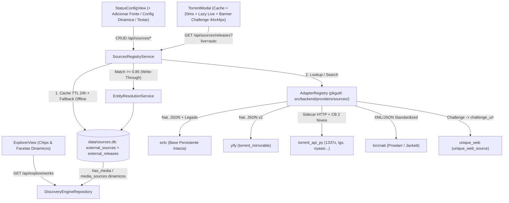

# Design Document — Sistema Extensível de Plugins para Fontes Externas (`sources.db`)

**Data:** 2026-11-19  
**Status:** Aprovado (Garimpo R1–R3 + Brainstorming Fase 5, $A_{\text{score}} = 0.00$)  
**Abordagem Selecionada:** Adapters 1:N Plugáveis + Instâncias Dinâmicas + Sidecar `Torrent-Api-py` / `Torznab` + Lazy-Cache 24h & Challenge Manual  
**Branch Base:** `UI-UX` (`ADR-011` + `ADR-012`)  

---

## 1. Declaração do Problema & Objetivos

Com a `ADR-012`, o **TV Pirata** separou a aba **Fontes de Dados** (`SourcesView.tsx`) e generalizou `data/sources.db` (`ExternalSourceRecord` e `ExternalRelease` em `sources_metadata`). Entretanto, adicionar novos provedores como `1337x`, feeds `Torznab` (Prowlarr/Jackett) ou fontes web únicas ainda exige editar código em quatro camadas (`REGISTERED_SOURCE_PROVIDERS` em `sources_registry.py`, `DATA_SOURCE_DEFINITIONS` em `canonical_taxonomy.py`, `discovery_engine.py` e `DATA_SOURCE_OPTIONS` em `ExplorerView.tsx`), além de não existir busca sob demanda (*lazy*) nem tratamento explícito de CAPTCHA/Challenge para fontes únicas não-torrent.

### Objetivos Mensuráveis
1. Preservar **EZTV** intacta como catálogo-base (`EZTVShow`, `CatalogShow`, `CatalogRelease` sobre `eztv_metadata`).
2. Separar **Adapters** (código Python descoberto automaticamente em `src/backend/providers/sources/`) de **Instâncias** (`external_sources` em `sources.db`) em relação `1:N`.
3. Integrar `Ryuk-me/Torrent-Api-py` (via sidecar HTTP) e `Torznab` (Prowlarr/Jackett) usando apenas `httpx>=0.28.0` sem adicionar scrapers HTML ou browsers ao core Python.
4. Suportar **Lazy-Cache (TTL 24h)** com fallback offline, limiar `>= 0.85` via `EntityResolutionService` para gravação em `MediaBadge`, e diagnóstico explícito de CAPTCHA/Challenge para abertura manual segura no navegador em fontes não-torrent únicas.
5. Deshardcodar completamente `ExplorerView.tsx`, `discovery_engine.py` e `StatusConfigView.tsx` com gerenciamento dinâmico e suíte contratual `pytest` universal.

---

## 2. Arquitetura & Fluxo Consolidado

---

## 3. Contratos Principais & Fluxo de Dados

- **`BaseSourceAdapter` (`src/backend/providers/sources/`):**
  - Atributos: `adapter_key`, `display_name`, `default_source_kind` (`"torrent_mirrorable" | "unique_web_source"`), `supports_sync`, `supports_search`.
  - Métodos: `config_schema()`, `sync()`, `search(query_ctx)`, `healthcheck()`.
- **Migração Aditiva em `sources.db` (`ExternalSourceRecord` & `ExternalRelease`):**
  - `ExternalSourceRecord`: `+ adapter_key`, `+ source_kind`, `+ config_json`, `+ priority`, `+ cooldown_until`.
  - `ExternalRelease`: `+ matched_by`, `+ match_confidence`, `+ last_checked_at`.
- **Segurança & Fallback:**
  - Whitelist de esquemas (`http://`, `https://`, `magnet:`) aplicada antes de salvar ou devolver URLs.
  - Mascaramento automático (`"••••"` + `has_secret: true`) para campos `secret=True` na API.
  - *Circuit breaker* em **2 níveis**: erro por `site` vs. cooldown compartilhado por host base do sidecar.
  - Em `unique_web_source`, detecção de anti-bot retorna `status: "challenge_required"` e `challenge_url` segura para o usuário abrir no navegador.

---

## 4. Non-Goals (Fora de Escopo desta Iteração)

- Não criar loja remota de plugins nem instalação de pacotes `.zip`/`.whl` terceiros via UI.
- Não embutir parsers HTML (`BeautifulSoup`, `lxml`, `playwright`) no backend FastAPI.
- Não automatizar resolução/bypass de CAPTCHA ou desafios anti-bot.
- Não migrar destrutivamente `EZTVShow` / `CatalogShow` para fora de suas tabelas atuais.

---

## 5. Próximos Passos

Formalizado via Quadra SOTA e Elevação Arquitetural em `docs/adr/ADR-013*.md` e `docs/adr/elevation-ADR-013/` para execução incremental em ondas.
